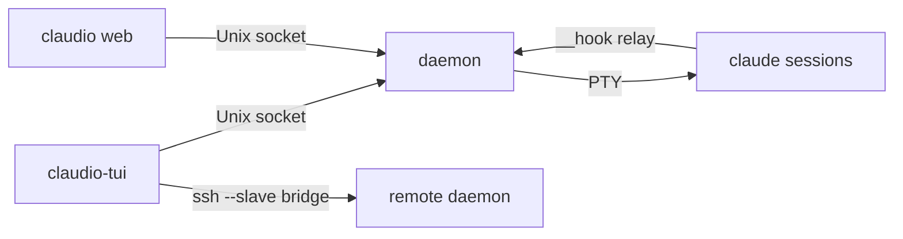

# CLAUDE.md

This file provides guidance to Claude Code (claude.ai/code) when working with code in this repository.

## What this is

`claudio` is a session manager TUI and drop-in wrapper for the `claude` CLI: a generic core
plus addons built into the same binary (the web UI, the API, the Vocdoni proxy client; see
"Workspace" and "Core and addons" below). It has four modes; `src/main.rs` only routes argv to
the core's words or an addon's (`Addons::relay`, the core words, `Addons::dispatch`, `--help`,
passthrough):

- **No arguments (bare `claudio`)**: it opens the **session manager** TUI — a terminal multiplexer for many Claude Code sessions, local and over SSH.
- **No `-p`/`--print`**: it `exec`s the real `claude` unchanged (passthrough).
- **`-p`** (the API addon): it emulates print mode by driving the *interactive* TUI under a PTY. It types the prompt, waits for the `Stop` hook, then reads the answer and real token usage from the session JSONL.
- **`--api`** (the API addon): it serves an OpenAI-compatible server (axum) on the same PTY backend, using a pool of persistent interactive sessions.

A build without the API addon refuses `-p`/`--print`/`--api` (before a bare `--`) with exit 2:
`claudio: print mode and the API server need the api addon; this build has none`.

**claudio never invokes `claude -p`.** Every path goes through the interactive TUI. Don't install the binary *as* `claude`, because it has to find the real one on `PATH` (or `$CLAUDIO_CLAUDE_PATH`).

## Acceptance rules

`ACCEPTANCE.md` is the bar every change meets before it merges (architecture: a generic core
plus addons, compatibility, security, quality, tests, docs). Check a diff against it and cite
the rule in reviews; `make check` runs the mechanical rules. The core/addons refactor that
introduces this shape is `docs/specs/2026-11-09-core-addons-design.md`.

## Commands

```bash
make                 # release build → target/release/claudio
make static          # static musl binary → dist/claudio (ARCH=aarch64 for cross)
make dev             # install this checkout to ~/.local/bin for testing, no release (make dev-undo reverts)
make check           # acceptance checks (ACCEPTANCE.md): fmt, clippy -D warnings, rules, core-only build, unit tests (workspace, then each crate alone)
make matrix          # the feature matrix: core only, each addon alone, all (make features FEATURES=web for one cell)
make test-unit       # unit tests only: cargo test --locked --workspace --lib --bins (no claude needed)
make test-manager    # manager integration tests (fake claude, no API key required)
make test            # unit + E2E (E2E needs an authenticated `claude` on PATH, ~5 min)
make e2e             # E2E only
make fmt             # cargo fmt
```

`make check`, `make features` and `make matrix` build in `target/check` with rustup's toolchain
when there is one (a distro clippy built for another rustc fails), so they never invalidate the
normal build; the first run compiles from scratch.

### Test suites and gates

**Manager integration tests** (fake `claude`, no real API):

```bash
make test-manager
# equivalent (crates/tui/tests/manager.rs):
cargo test --test manager -- --test-threads=1
# the same suite against the core alone (ACCEPTANCE A4):
cargo test --no-default-features --test manager -- --test-threads=1
# the TUI with the Vocdoni addon (addons/vocdoni/tests/manager.rs):
cargo test --test vocdoni_manager -- --test-threads=1
```

Must run single-threaded. Gated tests:

- `CLAUDIO_E2E=1` — enables `test_real_claude_session` (sends a prompt to the
  real `claude`, costs tokens, requires an authenticated `claude` on PATH).
- `CLAUDIO_PROXY_TEST=1` — enables the proxy-integration test (`vocdoni_manager`). It builds and
  runs claude-proxy from source (`$CLAUDIO_PROXY_SRC`, default `../claude-proxy`;
  needs `go`).
  The test for real-claude via proxy additionally needs `CLAUDIO_E2E=1` and
  `CLAUDIO_PROXY_URL`.

**Print-mode / API E2E tests** (addons/api/tests/integration.rs):

```bash
CLAUDIO_E2E=1 CLAUDIO_CADENCE=0 cargo test --test integration -- --test-threads=1 --nocapture
```

Without `CLAUDIO_E2E=1` the integration tests silently no-op. They call the
real Claude API and must run single-threaded.

**Remote / SSH tests** (tests/remote.rs, `required-features = ["diag", "vocdoni"]`):

```bash
cargo test --features diag,vocdoni --test remote -- --test-threads=1 --nocapture
CLAUDIO_SSH_TEST_HOST=<host> cargo test --features diag,vocdoni --test remote -- --test-threads=1 --nocapture
```

Tests `t1`, `t7`, `t8` are unit-style and always run. Tests `t2`–`t6` require
`CLAUDIO_SSH_TEST_HOST` to be set to a reachable SSH host alias.

**Web UI** (`claudio web`; fake claude and fake proxy, no API key):

```bash
cargo test --test web --test web_manager -- --test-threads=1   # server and TUI-with-web (addons/web/tests/)
cargo test --test vocdoni_web -- --test-threads=1              # proxy and plugins in the web (addons/vocdoni/tests/web.rs)
node --test addons/web/web/tests/*.test.mjs   # browser logic, no browser (glob form: the directory form fails on Node 22)
make test-web                                 # node tests, then Playwright e2e against a debug build (addons/web/web/e2e)
```

The e2e starts a real `claudio web` per spec file in `~/.cache/claudio/web-e2e/<hex>/`
with an isolated env (`XDG_*`, `HOME`, `CLAUDE_CONFIG_DIR`, `CLAUDIO_CLAUDE_PATH` = a fake
claude), so it never touches your own daemon or `~/.claude`. The `--remote` tests (the Rust
suites and `remote.spec.mjs`) use the committed fixture password
(`addons/web/web/e2e/fixtures/web-password`, password `claudio-e2e-password`). Needs Chromium in
`~/.cache/ms-playwright` and `npm ci` in `addons/web/web/e2e`. Run one spec:
`cd addons/web/web/e2e && npx playwright test board`. `addons/web/web/dev/mock-server.mjs`
serves the page against a mock (`MOCK_MANY=1`, `MOCK_FOREIGN=1`); `CLAUDIO_WEB_DIR=<dir>`
makes a debug build serve the page from disk instead of the embedded copy.

- Run one unit test: `cargo test --workspace --lib --bins <name_substring>`, or one crate's:
  `cargo test -p claudio-tui <name_substring>`.
- Run one E2E test: `CLAUDIO_E2E=1 CLAUDIO_CADENCE=0 cargo test --test integration <name> -- --test-threads=1 --nocapture`.
- CI runs the release build, the unit tests, `make check` and the feature matrix (`make features`,
  each cell), on Linux and macOS (claudio is Unix-only). Keep code compiling on both.

## Architecture

The in-depth references: `docs/addons.md` (the addon API and the crates),
`docs/manager-design.md` (daemon, screen model, hooks, recovery, SSH, upgrades),
`docs/daemon-protocol.md` (framing, features, addon ops, mixed versions), `docs/web.md` and
`docs/web-protocol.md` (the web UI), `docs/extensions.md`, `docs/print-and-api.md`.

### Workspace

One binary, `claudio`, built from a Cargo workspace (`docs/addons.md`, "Crates"):

```
Cargo.toml       [workspace] + the `claudio` package (features api, web, vocdoni: default; diag)
src/main.rs      wiring only: the core's words, `addons()` (the cfg'd registry), help, passthrough
crates/core      claudio-core     addon/ app/ claude/ client config daemon/ freshness paths proto
                                  release remote/ sys term/ text upgrade version
crates/tui       claudio-tui      the console manager and `--plain`        tests/manager.rs, tests/common/
addons/api       claudio-api      print/, api/, cli.rs, msglog.rs          tests/integration.rs
addons/web       claudio-web      src/ (the server), web/ (the page), build.rs   tests/web.rs, tests/manager.rs
addons/vocdoni   claudio-vocdoni  the claude-proxy client, the team plugins     tests/manager.rs, tests/web.rs
tests/           remote.rs, screenshots.rs (the whole binary), fixtures/
```

- **Dependencies (ACCEPTANCE A2, checked by `scripts/check_rules.py`):** the binary depends on
  everything; claudio-tui and each addon on claudio-core only; claudio-core on none of ours.
  An addon's dev-dependencies may add the TUI or another addon; the core's and the TUI's may
  not. `cargo build --no-default-features` is the core alone (A4).
- **`test-support`:** claudio-core's fixtures for other crates' tests (`TestAddon`, the daemon
  harness, the fake host) are `#[cfg(any(test, feature = "test-support"))]`, enabled only by
  dev-dependencies, so a release never links them.
- **Integration suites are root targets.** They drive the `claudio` binary, and Cargo gives
  `CARGO_BIN_EXE_claudio` only to its own package, so each file lives next to the crate it tests
  but is a `[[test]]` of the root `Cargo.toml` with the `required-features` it needs (`autotests
  = false` everywhere). The PTY harness is one file, `crates/tui/tests/common/mod.rs`, included
  by the other suites with `#[path]`.
- **`src/main.rs`** names `claudio_core::…`, `claudio_tui::run`, `claudio_tui::plain::args::run`
  and the addon crates directly; `addons()` registers vocdoni, web, api (api last: it parses
  whatever argv is left). Without the api feature, `route` refuses `-p`/`--print`/`--api`.

### Core and addons

The core (claudio-core and claudio-tui) wraps claude: the manager, `--plain`, the
daemon, SSH hosts, the installer, the passthrough. Addons (`addons/*`) add the rest through one
API, `crates/core/src/addon/` (`Addon` and its capabilities `Commands`, `Launch`, `Ui`,
`DaemonOps`; `AddonCtx`). Every addon string goes through `addon/clean.rs` (sanitising and
caps, applied by the runtime) before a front-end sees it; `addon/registry.rs` refuses reserved
words, core config sections, shared flags and shared panel keys.

- **api** (`addons/api/src/`): `Commands` only — the print relays, `-p`/`--print`, `--api`;
  see "Print-mode pipeline" and "API server" below.
- **web** (`addons/web/src/` the server, `addons/web/web/` the page): `claudio web`, see "Web UI"
  below (a bare `claudio web` saves `[web]` and the local daemon runs `claudio web --service` from
  it, supervised; `--foreground` serves from the terminal; `claudio web stop|status`); its `Launch` gives every session the `latex` and `mermaid` lenses while
  `[extensions] latex`/`diagram` are on (`[claude] latex = false` is the alias the runtime maps).
- **vocdoni** (`addons/vocdoni/src/`): the claude-proxy client (`vocdoni login|status|use|logout`,
  alias `proxy …`; `[proxy]` profiles; the "Proxy stats" panel on Alt+s) and the team plugins
  (manifests from `GET /v1/claudio/plugins`, one checklist per manifest, installed on the
  daemon by the `vocdoni/apply` addon op). `state/` is the one plugin state machine, pure;
  `runner.rs` does its I/O. Its `on_usage_limit` (`proxy/limit.rs`) moves a proxy session to
  another subscription when a turn ends on a usage limit, and the daemon
  (`daemon/session/limit.rs`) then types `continue` (`[proxy] auto_switch = false` turns it off).

**A3 across crates:** the core crates cannot import an addon (A2: no such dependency) and
never branch on an addon's name; an addon imports `claudio_core::addon`, the core's public
services and its own modules, and reads and writes only the `config.toml` tables it
declares. The services addons use today: `paths` (all); `term::{probe, strip_escapes}`
(api); `proto`, `text`, `client`, `remote::bootstrap`, `term::secret` and
`app::{addons, launch, browser}` (web and vocdoni); `claude::SESSION_MARKERS` and
`app::config_edit` (vocdoni, web; and `daemon::test_support` in the web's tests); `config`, `freshness`, `claude::{hooks, update}`,
`remote::{hosts, validate_host}`, `sys::hostname` and `app::label` (web). The web addon (the former in-tree web UI, a second front-end) also uses
`app::{state, connections, extensions, snippets}`: the layer both front-ends share (A5).

### Session manager (bare `claudio`)

A bare `claudio` calls `claudio_tui::run()`. One daemon per host owns the sessions; the TUI and
the web UI are clients of it, locally over a Unix socket and remotely over an ssh bridge.



- **Wire protocol** (`crates/core/src/proto.rs`): frames are `[u32-BE length][u8 tag][payload]`.
  Tag `J` carries JSON control messages (`Envelope { req, msg: Msg }`; unknown fields ignored),
  tag `D` terminal bytes (`[16-byte session UUID][raw bytes]`). `PROTO` (`version.rs`) is in the
  socket file name, so old and new daemons coexist.
- **Daemon** (`crates/core/src/daemon/`, `claudio --daemon`): one actor task per live session
  (`session.rs`) owns the PTY writer, the VT engine (`alacritty_terminal`) and the subscribers.
  Hook events (`__hook <Event> <socket> <token>`) are authenticated by uid plus a per-spawn token.
  The journal (`journal.rs`, `daemon-sessions-v1.json`, atomic writes, no secrets, `--plain`
  sessions not written) re-spawns sessions with `claude --resume` on a fresh start. Slow
  requests (git, `UpdateClaude`, attach, `Answers`) reply from spawned tasks, never inline.
  `service.rs` runs the addons' services (`DaemonOps::service` and `DaemonCtx::service_reload`/
  `service_state` in `addon/daemon.rs`, `ServiceState`): one child per daemon-side addon from its
  config sections (`Config::claudio`, own process group, stdin a pipe the daemon never writes,
  a `ready` line; `Config::config_file`, `service_timing`), stderr in `<runtime>/<addon>.log`
  (≤ 2 MiB), restarted with a 1–60 s backoff; started after the socket listens, stopped before
  the lock goes (stdin closed, SIGTERM, SIGKILL after 3 s; `serve_until_shutdown`).
  `command.rs` builds the command line and scrubs the env (`SESSION_MARKERS` plus the spec's
  `env_remove`), dropping `optional` flags this claude's `--help` lacks.
- **Finding claude:** `Config::claude_bin()` resolves it on every use: `$CLAUDIO_CLAUDE_PATH`,
  else `claude` in `Config::path`, else well-known install dirs. `Config::path` is the user's
  login-shell `PATH` (`login_path.rs`, read once at daemon start, 3 s deadline) merged before
  the inherited one, because a daemon started over ssh only has the system `PATH` and can find
  a stale `/usr/local/bin/claude`. It is the `PATH` of every session, probe and `claude update`.
  A service child gets the daemon's whole environment, not the terminal's that ran `claudio web`.
- **Freshness** (`freshness.rs`): each host's daemon is kept at least as new as the claudio
  binary on it. An older daemon is restarted from the current binary unless `busy` (a claude
  turn, a permission prompt, a `--plain` session); then the client is flagged
  `daemon_outdated` (over SSH the bridge prints `DEFERRED`) and the TUI reconnects that host
  once it is idle. `freshness::EXIT_WAIT` is also the starter's wait for the lock.
- **Remote** (`crates/core/src/remote/`): `bootstrap.rs` probes the host (`__probe` + `uname -sm`
  in one round trip; a failed probe reports ssh's stderr, and `ssh_cmd` uses
  `StrictHostKeyChecking=accept-new`) and uploads the binary if missing or stale (SHA-256);
  cross-platform it uploads the release asset. `bridge.rs` is `--slave`, the stdio↔socket bridge,
  starting or replacing the remote daemon. Agent forwarding (`[ssh] forward_agent` per host,
  `ssh_cmd`'s `-o ForwardAgent=yes`): `agent.rs` links the bridge's live `SSH_AUTH_SOCK` under
  `<runtime>/agents/`, and the daemon's relay (`daemon/agent.rs`, `agent-v{PROTO}.sock`) is every
  session's `SSH_AUTH_SOCK` once one exists (docs/manager-design.md §2.4.1).
- **The shared layer** (`crates/core/src/app/`, no ratatui, crossterm or axum; the web imports
  nothing from claudio-tui): `addons/` (`AddonRuntime`, the one `AddonCtx` implementation),
  `launch/` (the launch composer), `config_edit.rs` (every `config.toml` writer: a minimal,
  atomic section edit under one process-wide lock), `state.rs` (`state.json`),
  `connections.rs`, `extensions/` (the registry, external manifests in
  `~/.config/claudio/extensions/`, the extension host), `snippets.rs`.
- **Launch composer** (`app/launch/`): the one path of a claude session's `Spawn`/`Respawn`,
  from the TUI, `--plain` and the web. Resolve (every `Launch` addon's `Routing`; a `Required`
  addon that fails fails the launch, never direct) → prepare (25 s budget) → review
  (`NeedsReview` parks the launch) → `compose.rs` (env layered, `env_remove` unioned, optional
  args, lenses merged, instructions cut at 8158 bytes). A saved route this build cannot make
  is kept and fails its launches, never falls back to direct.
- **TUI** (`crates/tui/src/`): `lib.rs` is the I/O edge (terminal, event loop, every `Effect`);
  `app.rs` is the pure coordinator; `interaction.rs` keys, mouse and modals; `sessions.rs`
  builds every spawn (`send_spawn`; a claude session is an `Effect::Launch`);
  `addon_runner.rs` is the TUI's edge of the addon runtime and the launch composer, and keeps
  parked launches out of `App`; `keymap.rs`'s `DEFAULT_BINDINGS` is the single source of truth
  for keys (`Alt+Shift+<digit>` is fixed, outside it); `plain.rs` is `--plain`; `ui/` draws.

### Web UI (`claudio web`, `addons/web/src/`, `addons/web/web/`)

`claudio web` (the web addon's `Commands`; flags in `docs/web.md`) serves the manager to a
browser. Without `--foreground` it checks its flags, saves `[web]` in `config.toml` and has the
local daemon run `claudio web --service` (supervised: restarted with backoff, stopped with the
daemon), then prints the URL and exits (`cli.rs`, with `stop`, `status`, `restart_if_enabled`;
`service.rs` maps `[web]` to argv); `--foreground` serves from the terminal and never touches
`[web]`. The server is one more client of the daemons, like the TUI, over the same socket and ssh bridge.
A browser it opens signs in with a single-use ticket through a 0600 redirect file (`ticket.rs`); `--app`
opens a Chromium-family app window instead of a tab, `--app=<url>` another machine's web (`app_window.rs`),
and `--install-launcher` writes a desktop launcher for it (`launcher/`).
`docs/web-protocol.md` is the contract between server and page (version 2: `addons.*` ops,
the Session's `launch` and `segments`); change it first, in its own commit. User docs, the
security model and the TUI parity table: `docs/web.md`.

- **Server** (axum, loopback only unless `--remote`): `auth.rs` (token, the cookie with
  `Max-Age=34560000`, `Host`/`Origin` checks, the CSP), `sessions.rs` (sign-ins as hashes in
  `web-sessions.json`, bound to an epoch; 30 days idle, 64 at most), `hub_io.rs` (the plain
  connect for `--service`), `login.rs` + `limit.rs` + `password.rs` (token, ticket or argon2id
  password login, rate-limited), `tls/` (`--remote`'s kept self-signed certificate), `ws.rs`
  (the WebSocket), `hub.rs` (one actor owning hosts, daemon connections, sessions, tabs and
  `web-state.json`), `dto.rs` (DTOs built field by field, never a serialized `Profile`,
  `SpawnSpec` or `Applied`), `spawn.rs` (spawns through the launch composer, as the TUI's).
- **Page** (no build step; ES modules through the import map in `index.html`): `app/` pure
  logic with node tests, `app/ui/` Preact components (`htm`, signals), `app/render/` markdown,
  KaTeX, mermaid and highlight behind DOMPurify, `styles/tokens.css` the design tokens,
  `vendor/` pinned upstream files. `addons/web/build.rs` gzips the page into the binary and
  hashes the import map for the CSP.

### Print-mode pipeline (`-p`, the API addon: `addons/api/src/`)

1. `cli.rs` handles arguments *dynamically*. It owns only a few flags (`-p`, `--api`, `--fast`, `--log-messages[-file]`, `--output-format`, `--input-format`, `--settings`, `--session-id`), drops `--bare` and `--no-session-persistence` with a warning (they would disable hooks and the JSONL), and forwards everything else verbatim. Never add a mirror of claude's flag grammar. Wrapper-only knobs belong in `CLAUDIO_*` env vars (`WrapperEnv`) so the CLI surface stays exactly claude's. `cli::HELP_APPENDIX` documents these flags and env vars and is appended to `claudio --help`; update it when you add one.
2. `print/driver.rs` spawns claude under a PTY (`portable-pty`). `PtySession` is the reusable unit: spawn, then `turn(prompt)` repeatedly. `driver::run` is the single-shot `-p` path built on it.
3. `claudio_core::term::probe` answers the terminal probes that Ink sends at startup (DA1/DA2, DSR, XTVERSION, OSC colors…), byte-for-byte as xterm-380 would.
4. `print/hooks.rs` signals completion. `SessionStart`/`Stop` hooks are injected via a merged `--settings` and report back over loopback TCP (default) or a watched directory (`CLAUDIO_HOOK_TRANSPORT=file`). The hook command is a copy of this binary under a random hex name in `/tmp`, so relay invocations are recognized first (`ApiAddon::is_relay`, run by `Addons::relay` before any core word): argv `<EventName> <port>` (concealed relay) or `__hook <Event>` (legacy; the five-word `__hook` is the core's manager relay).
5. `print/session.rs` reads the session JSONL, which is the source of truth for the final assistant text and usage. The terminal render is never parsed for answers.
6. `print/emit.rs` formats output as `text`, `json`, or `stream-json`, shaped like `claude -p`.

### API server (`--api`, `addons/api/src/api/`)

- `routes/chat.rs` takes a request down one of two paths:
  - **plain**: `prompt.rs` flattens `messages[]`.
  - **agentic** (request has `tools` and `CLAUDIO_API_AGENTIC` is on): `agentic.rs` builds a "tool-execution gateway" prompt and parses a fenced ```` ```tool_calls ```` block back into OpenAI `tool_calls`.

  Either way, the turn is resolved whole, so streaming is "resolve then chunk" into a fixed SSE set.
- `backend.rs` dispatches to `pool.rs` (`SessionPool`). OpenAI clients resend the full history, so the pool matches a request to a live conversation with a cumulative **prefix-hash chain** and types only the delta.
  - Past `CLAUDIO_API_MAX_LIVE`, LRU sessions are demoted: the process is killed and the mapping kept. They are revived later with `claude --resume`.
  - The system/agentic prompt is re-injected every `CLAUDIO_API_REINJECT_TURNS` turns.
- `config.rs` reads `CLAUDIO_API_*` env vars, falling back to legacy `OPENAI_PROXY_*` names. `--api` implies `CLAUDIO_FAST=1`.

## Non-obvious constraints (don't "fix" these)

### Manager

- **Keys must never collide with claude/terminal bindings.** All manager keys
  use the `Alt` modifier. `keymap.rs` enforces no-collision among manager
  bindings; the `config.toml` parser rejects collisions with a notice.
- **`Attached` precedes the snapshot `D` frames.** The daemon sends the
  `Attached` control message, then immediately the snapshot as a `D` frame.
  The client must not render anything until it has received `Attached`.
- **Protocol additions must be backward compatible.** New `op` values in `Msg`
  must be accepted (ignored) by older daemons. New `SessionEvent` variants
  deserialize to `SessionEvent::Unknown` so an old client never panics.
- **The PTY test harness asserts on the rendered screen model, never on raw
  bytes.** All `wait_for` calls in the manager suites (`crates/tui/tests/common/mod.rs`) operate on the
  `alacritty_terminal::Term` VT model. Asserting on raw bytes is fragile and
  forbidden.
- **Don't send `ESC` immediately before `Alt+key` in tests.** `ESC ESC q` is
  ambiguous — the VT parser may interpret it as two separate `ESC` sequences.
  Use the crossterm key-event encoding instead.
- **Secrets never go in argv or state files.** Proxy tokens and plugin env
  are passed only through `Spawn.env` over the Unix socket (from an addon's
  `LaunchPart.env`, whose `Debug` shows keys only); an `AddonOp` body
  (`vocdoni/apply`) carries secret names, never values, and is never logged. The journal and `state.json`
  never hold secrets (profile names only); `config.toml` and
  `plugins.json` do, both mode 0600. Logs and notices name keys, never
  values. The `--mcp-config` JSON on argv holds `${NAME}` placeholders
  that claude expands from the env; `--agents`/`--mcp-config` are added by
  claudio's spawn path only, never parsed from the user's args.
- **Plugins are installed by the CLI, never with `-y`.** The daemon runs
  `claude plugin … --json` and never writes `~/.claude` itself; a
  marketplace-declared command (`shownCommand`) is left for a person.
- **New request ops must fail safe on old daemons.** An old daemon answers an
  unknown op with `Error "unsupported op…"`; `App::older_daemon_notice` turns
  that into "run `claudio daemon restart`". Never add a field to an existing
  op that an old daemon would silently ignore into wrong behaviour (that is
  why terminals are `SpawnShell`, not `Spawn{kind}`, and plugin manifests
  are an `AddonOp` (`vocdoni/apply`, behind `addon:vocdoni` in
  `Welcome.features`), not a `SpawnSpec` field: an old daemon's error
  becomes `daemon too old` and the session starts without the plugin;
  `SessionExtensions.instructions` is `#[serde(default)]`, which an old
  daemon ignores harmlessly).
- **A daemon is replaced only by a newer build.** `freshness::compare` orders
  builds by version, then binary mtime; "different" is not enough, or two
  binaries (a release and a dev build) would replace each other's daemon
  forever. A daemon keeps its startup lock until it has fully stopped, so
  its successor never runs beside it.
- **Test fakes and the test config.** The daemon runs `claude --help` once to
  probe for flags, so fake claudes must ignore `--help` (and `--version`)
  without side effects. Every test claudio starts with `[claude]
  update_check/remote_check/install = "off"`: the update prompts are modal
  and would swallow the keys a test types, and an install would run the
  installer (`test_missing_claude_is_installed_at_start` turns it on with a
  fake `curl` and a `PATH` that reaches no real one). Tests never read real
  rc files: the manager harness pins `SHELL=/bin/sh` with a temp `HOME`.
- **`app.rs` is pure; I/O is only in `crates/tui/src/lib.rs`.** `App::update` takes
  events and returns `Effect` values. `lib.rs` drives the effects. Don't add
  I/O to `app.rs`.
- **The console TUI stays plain (A7, spec G5).** The pane shows claude's
  screen as claude drew it, and the reader shows formulas and diagrams as
  their source. Formulas, diagrams and lenses render in the web UI only;
  the TUI still sends the registry's lenses with every spawn, because the
  web UI renders them from the daemon's `Lens`/`Latex` events. Don't add an
  overlay or renderer to the TUI.
- **The reader's markdown is parsed off the UI thread** (`spawn_blocking`):
  the transcript is attacker-influenced. `App` and the drawing only lay out
  the parsed `Doc`.

### Web

- **`DESIGN.md` is the web UI's style reference; every UI change follows it.** Dark only;
  surfaces Void `#0b0e12` → Carbon `#181a1d` → Graphite `#1f2124`, 1px Slate `#303235`
  hairlines, radius 1px, no shadows, weight 400 only, mono (JetBrains Mono) for every
  technical label/tab/badge/button with wide tracking, sans (Inter) for prose; Phosphor Green
  `#00d892` only for active/status, Deep Teal `#002923` the only filled button. Two owner
  decisions on top of it: text sizes stay at the owner's larger scale (not DESIGN.md's
  marketing-site 11–14px), and session states map to working = green, waiting = Syntax
  Violet `#c58aff`, stopped = Steel `#818284`, error = Syntax Coral `#ff6285`. The tokens live
  in `addons/web/web/styles/tokens.css`; never hard-code a colour, radius or font outside it.
- **The import map is the only inline script, and its hash is in the CSP.** `build.rs`
  hashes the map's exact text; editing it changes the hash (a rebuild picks it up). No other
  inline script, inline handler, `eval` or CDN, ever. The e2e asserts zero
  `securitypolicyviolation` events.
- **Vendored files under `addons/web/web/vendor/` are byte-identical to upstream.** Delete whole files
  (mermaid reduction rule) but never edit one; every file is in `MANIFEST.txt`.
- **The web never writes `state.json`.** It reads it; its own state is `web-state.json`,
  `web-sessions.json` and `web-token`, all written with `paths::write_atomic` (0600).
- **`--remote` is the only non-loopback listener, and it is TLS.** `listen_addr` still refuses
  non-loopback `--listen`; with `--remote` the token works for local requests only (loopback
  peer **and** loopback `Host`), so a reverse proxy on the same host never turns internet users
  into token holders. No HSTS: it would stop browsers from accepting the self-signed
  certificate later.
- **`claudio web --service` never prints or logs the token; it only loads it.** The suites start
  servers with `--foreground`; `CLAUDIO_TEST_SERVICE_HANG` is debug-only (like
  `CLAUDIO_TEST_REMOTE_PEER`). `CLAUDIO_WEB_DIR` works with `--foreground` (a service has the
  daemon's environment).
- **The suites' remote peer is a debug-only hook** (`CLAUDIO_TEST_REMOTE_PEER`); it only ever
  takes the token away.
- **No token or ticket in a browser's argv.** A browser claudio opens gets
  `file://<runtime>/web-open/<hex>.html` (0600), which carries a single-use ticket; only a snap or
  flatpak browser gets the `#k=` link in argv, with a warning. With `--app` and stdout not a
  terminal, nothing that holds the token is printed. Tests put fake browsers, openers and
  notifiers on `PATH` and in `CLAUDIO_BROWSER` (`web_harness/app.rs`), never a real one.
- **DTO fields are fixed by `docs/web-protocol.md`.** A new field or message changes the doc
  first. Session ids are `sid` in every request and event (an `id` argument would collide with
  the request id); only the Session DTO keeps `id`.
- **`SessionEvent::Attention` is nested** (`SessionEvent::Attention { attention }`) because the
  payload's own `kind` would collide with the enum's `kind` tag.
- **Secrets stay server-side.** Proxy tokens and plugin env go only in `Msg::Spawn`/`Respawn`
  over the daemon socket; nothing env-bearing is serialized into a DTO, log or notice.
- **Approve is guarded in the hub actor** (state + attention kind + seq, no await between
  check and send); a stale click answers `"stale"`, it never types into the wrong prompt.
- **Pure browser modules import nothing through bare specifiers**, so `node --test` runs
  them without a browser; keep UI-only imports in `app/ui/`.
- **Stable `data-testid`s are the e2e's interface** (listed in the plan's Global Constraints); rename one and
  the Playwright specs break.

### Print mode and the API server

- **The system prompt goes in the typed user message, never `--system-prompt`.** Anthropic classifies the system prompt of interactive requests. A third-party-looking one gets the request billed as a third-party app (`400 … extra usage`). The user message isn't scored.
- **The client's system prompt is never relayed verbatim in agentic mode.** A prompt describing another harness ("you are operating inside pi…") makes Opus/Sonnet treat it as prompt injection. `agentic.rs` instead reads it for facts: `ClientEnv::detect` fingerprints pi, opencode, hermes, or generic, and extracts the working directory and date. It then presents its own neutral gateway framing.
- **Tool argument help is rendered from each client's JSON Schema.** Don't add hardcoded per-name argument tables, because clients name the same concept differently (pi `path` vs opencode `filePath`).
- **API sessions run with `--tools ""`, `--strict-mcp-config`, `--disable-slash-commands`, and `--setting-sources project`, in a clean cwd** (`CLAUDIO_API_CWD`, default `/tmp`). The server never executes tools; the client does.
- **Prompts are typed with bracketed paste** (auto-detected from `?2004h`) so multi-line prompts submit atomically. Typing cadence and delays are cosmetic (`CLAUDIO_CADENCE`, `CLAUDIO_FAST`). The Ink-quiescence wait is a correctness wait.

## Debugging

- `CLAUDIO_DEBUG=1` prints a trace timeline.
- `CLAUDIO_RAW_LOG=<path>` dumps the raw PTY bytes.
- `--log-messages` (`msglog.rs`) logs all four hops (CLI→claudio→claude→claudio→CLI), correlated by id. `--log-messages-file <path>` writes them untruncated as JSONL.
- The API server logs pool decisions at INFO (`MATCH`, `RESUME`, `demoting LRU`).
- `claudio daemon status|stop|restart`: status shows the claude path and version the daemon uses.

`docs/print-and-api.md` has the full env-var tables and client configs for pi, opencode, and hermes. Docker (`docker-compose.yml`) mounts `./workspace` as `/work`.
