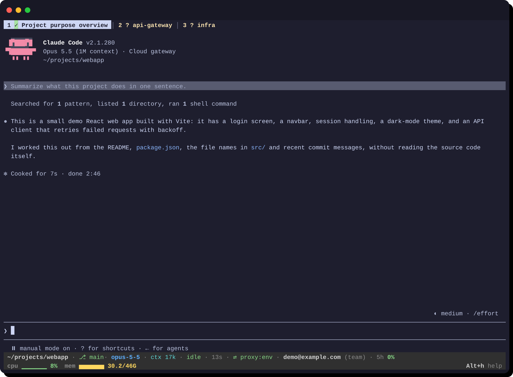
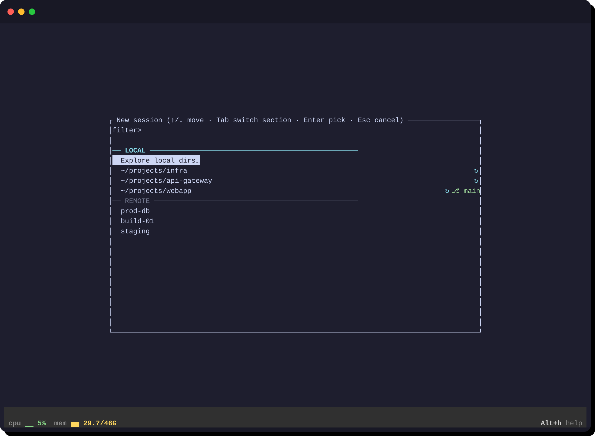
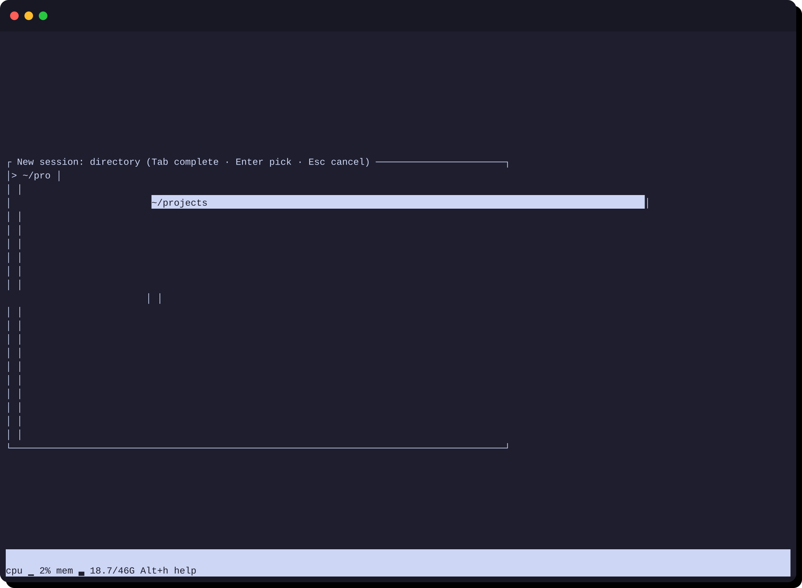
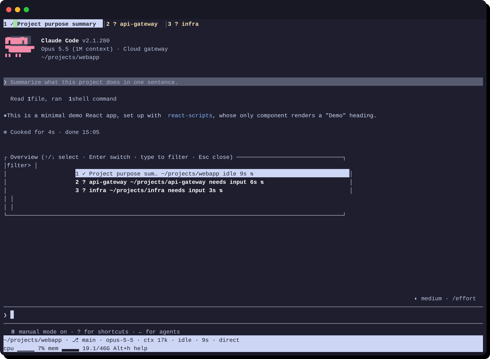
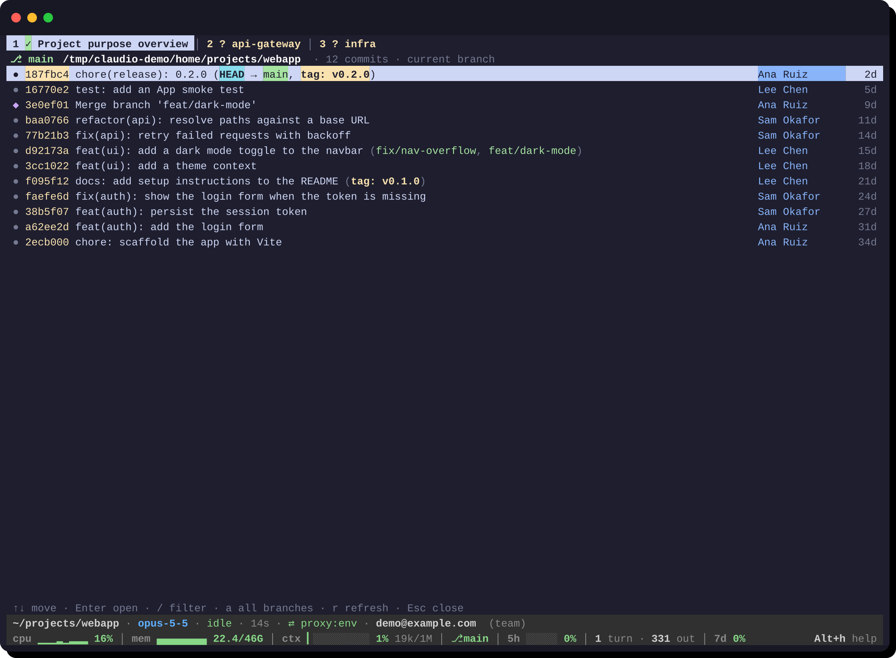
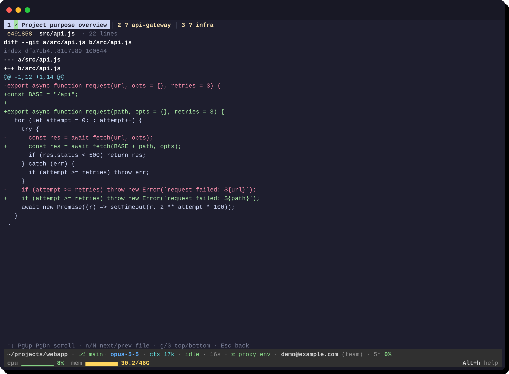
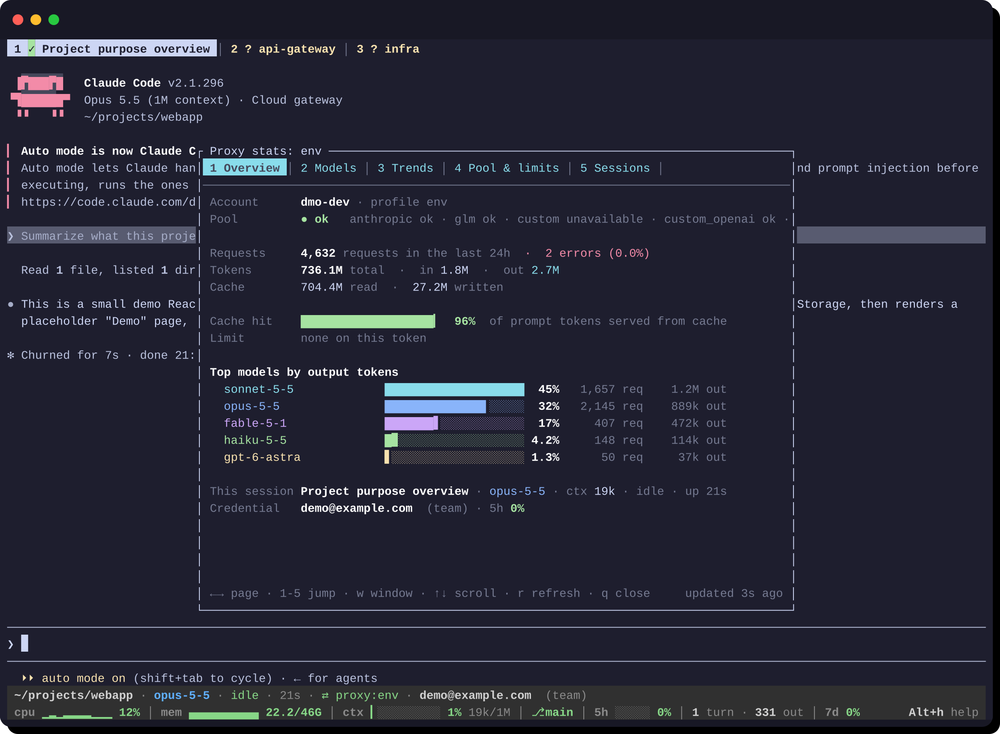
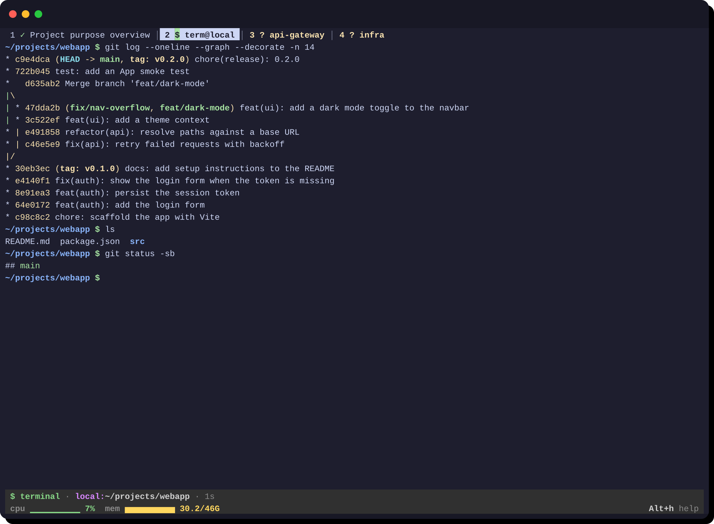

# claudio

A terminal-native session manager for [Claude Code](https://claude.ai/claude-code). Run many Claude Code sessions, local and over SSH, in one terminal window. Sessions survive closing the UI or an SSH drop, and pick up where they left off.

claudio is a small core (the session manager, `--plain`, the daemon, SSH hosts, the claude installer and the plain `claude` passthrough) that works with your own `claude` login, plus **addons** built into the same binary: the **web UI** (`claudio web`), the **API addon** (`claudio -p` and the OpenAI-compatible `claudio --api`) and the **Vocdoni addon** (the claude-proxy client and the team plugins, `claudio vocdoni …`). [docs/addons.md](docs/addons.md) is the addon API.

---

## Screenshots

<!-- Regenerate: CLAUDIO_SCREENSHOTS=docs/screenshots cargo test --test screenshots -- --nocapture -->



*The active session with Claude Code running. The tab bar shows every session with a state glyph; amber and red tabs need attention. The two-line status bar shows the session, then the host's CPU and memory, the context gauge, the git working tree, the credential's rate-limit windows and the conversation totals.*



*The new-session wizard. LOCAL starts with your recent directories; REMOTE lists SSH hosts from `~/.ssh/config`.*



*The directory browser. `▸ start here` starts the session in the directory you are looking at.*



*Alt+g: all sessions at a glance.*



*Alt+l: the git viewer lists the session directory's commits, with branches, tags and merges.*



*Enter on a commit and then on a file shows its colored patch; Esc steps back one page at a time.*



*Alt+s: the Vocdoni addon's proxy stats panel, here on its Overview page (account, pool health, usage, top models, this session's credential).*



*Alt+c opens a `$ term@local` terminal tab right next to the active session, in the same directory.*

---

## Install

```bash
curl -fsSL https://github.com/p4u/claudio/releases/latest/download/install.sh | bash
```

**Options** (environment variables before the command):

| Variable | Default | Description |
|---|---|---|
| `CLAUDIO_VERSION` | latest | Pinned release tag, e.g. `v0.3.0` |
| `CLAUDIO_INSTALL_DIR` | `~/.local/bin` | Where to place the `claudio` binary |

**From source:** `make install` builds a static binary, installs it, and restarts a running daemon.
`make` builds `target/release/claudio`, `make static` a static `dist/claudio`, `make check` runs the
acceptance checks and `make test-unit` the unit tests (`cargo test --workspace --lib --bins`). The
source is a Cargo workspace: the core in `crates/core` and `crates/tui`, the addons (API, web
UI, Vocdoni) in `addons/`, each a cargo feature, all on by default. To build without some,
pick the ones you want: `cargo build --release --no-default-features --features web,vocdoni`
(no features at all is the core alone; `make matrix` builds and tests each combination).

**Platforms:** Linux and macOS, x86\_64 and arm64.

---

## Quick start

### With your own claude login

**Requirements:** a [Claude Code](https://claude.ai/claude-code) account, and `~/.local/bin` on your `PATH`. Where claude is missing, claudio installs it (see [Keeping claude up to date](#keeping-claude-up-to-date)); you log in the first time it starts.

1. [Install](#install) claudio and run `claudio`.
2. The new-session wizard opens. Pick **Explore local dirs…** to browse from your home directory, one of your recent directories, or an SSH host under *Remote*.
3. Start a new conversation or resume a previous one from that directory.
4. Work as usual. Only `Alt` keys are claudio's; everything else goes to Claude Code. `Alt+h` lists them all.
5. Close the UI with `Alt+q` (sessions keep running) and run `claudio` again later: everything is where you left it.

**SSH:** pick a host under *Remote* (key-based `ssh <host>` must work without a password). claudio installs itself on the remote, and those sessions survive disconnects too.

### The Vocdoni addon: claude-proxy and team plugins

[claude-proxy](https://github.com/p4u/claude-proxy) is a multi-subscription credential proxy for Claude Code: sessions authenticate through it instead of a local `claude` login. The Vocdoni addon is its client.

```bash
claudio vocdoni login                           # sign in to https://claude.vocdoni.net through the browser
claudio vocdoni login https://proxy.example.com # or to another claude-proxy
claudio                                         # new sessions now use the proxy by default
```

`claudio proxy …` is an alias of `claudio vocdoni …`, with the same subcommands (`login`, `status`, `use`, `logout`). `claudio vocdoni login` prints a page and a one-time code, opens the page in a browser when there is a display (`CLAUDIO_NO_BROWSER=1` only prints it), and waits while you sign in and type the code there. The proxy then hands claudio your own token, saved with your e-mail in the profile (`claudio vocdoni status` shows it). Without a URL it signs in again to the default profile's proxy, or, with no profile yet, to `https://claude.vocdoni.net`. `--token`, or a proxy without browser sign-in, asks for a pasted token instead (read from stdin when it is not a terminal); a token is never an argument.

The proxy can also serve **plugins**: a pinned manifest (a TOML file, hash-checked) that says what a member needs: marketplaces and the Claude Code plugins to install from them, MCP servers (with the secrets they need, which the proxy serves as env), subagents, instructions for every session and env. The first time claudio sees a manifest it shows every item in a setup screen, all on; you turn off what you don't want and press Enter (the choice is saved under `[plugins.<name>]` in `config.toml`; Esc asks again at the next start). Then each host's daemon installs the plugins in your user scope with `claude plugin install` (never with `-y`: a plugin whose marketplace runs a command is left for you to install by hand), and every session claudio opens with that proxy profile (manager, `--plain`, SSH hosts) gets the servers (`--mcp-config`, secrets only in its env), the agents (`--agents`) and the instructions. What you already have stays yours: an installed plugin, a marketplace, an MCP server or an agent of the same name is left alone. The list and its env are cached in `~/.config/claudio/plugins.json` (mode 0600), so a session still gets them when the proxy is unreachable, and refreshed every 15 minutes. `claudio vocdoni logout` deletes them. Plugins are listed in the extensions screen (`Alt+i`): `Space` turns one off for new sessions, `Enter` opens its setup screen again, and its details say, per host, what was installed, what was already there, what is still installing and what was skipped and why. A failed install is tried again after 15 seconds, then twice as long each time it fails again, up to every 5 minutes (the details say `retrying in N s`). Installed plugins stay until you remove them (`claude plugin uninstall <id>`).

- `claudio --no-proxy` or `claudio --proxy <profile>` overrides the default for one run.
- `CLAUDIO_PROXY_URL=<token>@proxy.example.com claudio` uses a proxy for one run without saving a profile.
- The status bar shows which upstream credential the session is running on (the addon's segments), and `Alt+s` opens the proxy stats (the addon's panel).
- Proxy sessions use gateway mode by default: `ANTHROPIC_BASE_URL` points at the proxy, and Claude Code gets `CLAUDE_CODE_USE_GATEWAY=1` and `CLAUDE_CODE_DISABLE_NONESSENTIAL_TRAFFIC=1`. Claude Code turns its feature flags off in that mode, so Monitor, `/advisor`, WebSearch and PushNotification are unavailable.
- First-party mode is opt-in, for a profile (`first_party = true` in `config.toml`, under `[proxy.profiles.<name>]`) or for one run (`claudio --first-party`, also with `--proxy` and `--plain`). The session then runs as a first-party Claude Code client: the gateway variables are left out, so the feature flags stay on and Monitor, `/advisor`, WebSearch, PushNotification and the other flag-gated features work. WebSearch works only if the proxy passes Anthropic's server-side web search tool through. The session also gets `DISABLE_AUTOUPDATER=1`, so claude does not update itself behind claudio's `[claude] update_check`, and `ENABLE_TOOL_SEARCH=true`, which keeps tool search on (Claude Code turns it off for a non-Anthropic base URL; claude-proxy passes the `tool_reference` blocks through).
- The cost of first-party mode: Claude Code's telemetry and feature-flag requests go to api.anthropic.com, not only to the proxy, and on a host where claude has never been set up, the onboarding screens may appear once.
- A session started with `--first-party` keeps it when it is restarted (`Alt+e`) or restored after a claudio restart, so its env does not change under it.

> [!NOTE]
> An exported `CLAUDE_CODE_DISABLE_NONESSENTIAL_TRAFFIC` is kept, and it turns Claude Code's feature flags off as well. Monitor and the other flag-gated features then stay off even with `first_party = true`. Unset it for first-party sessions (`unset CLAUDE_CODE_DISABLE_NONESSENTIAL_TRAFFIC`).

### Just one claude, with the proxy (`--plain`)

```bash
claudio --plain [--proxy NAME | --no-proxy] [--first-party] [claude args…]
```

One full-screen claude session with the proxy configured: no tabs, no status bar, no saved state. It feels like plain `claude`, and exits when claude does, with claude's exit status. Only seven keys are claudio's: `Alt+h` help, `Alt+s` proxy stats, `Alt+l` git history, `Alt+e` restart, `Alt+u` reader view, `Alt+z` extension actions, `Alt+i` extensions screen. Everything else, and every argument, goes to claude.

### Everyday commands

| Command | What it does |
|---|---|
| `claudio [--proxy NAME\|--no-proxy] [--first-party]` | Open the session manager |
| `claudio --plain …` | One plain claude session with the proxy configured |
| `claudio sessions` | List sessions as a table (for scripts) |
| `claudio daemon status\|stop\|restart` | Inspect or control the background daemon |
| `claudio vocdoni login\|status\|use\|logout` | Manage proxy profiles (Vocdoni addon; `claudio proxy …` is an alias) |
| `claudio web` | The session manager in a browser (web addon) |
| `claudio upgrade [--check]` | Install the latest release, or only check for one |
| `claudio -p "…"` | Drop-in for `claude -p` ([details](docs/print-and-api.md)) |
| `claudio --api` | OpenAI-compatible API server ([details](docs/print-and-api.md)) |

---

## What it does

A per-host background daemon owns the sessions, so they keep running after you close the UI or lose an SSH connection. When the UI comes back every session is restored, and interrupted ones are recovered with `claude --resume`.

### New-session wizard

`Alt+n` opens the wizard (it also opens when there are no sessions).

1. **Start screen.** *Local* has **Explore local dirs…** and your recently used directories, annotated with their git branch (⎇) and last claude activity (✻). *Remote* has your SSH hosts: recently used first, then every `Host` in `~/.ssh/config`. Typing filters both; `Tab` switches between them.
2. **Directory browser.** It opens at the host's home. `▸ start here` starts the session in the directory you are looking at. `→` or `Tab` opens the highlighted folder, `←` or `Backspace` goes up, and `Enter` picks the highlighted row. Typing a path narrows the list; typing anything else fuzzy-searches your recent and project directories. Dot-directories are hidden; `Alt+.` shows them.
3. **New or resume.** If the directory has earlier Claude Code conversations, pick one to resume or start a new one.

`Backspace` on an empty input goes back a step.

### Tabs and attention

Each tab shows the session name and, for remote sessions, the host. Its glyph shows the state:

| Glyph | State | Tab color |
|---|---|---|
| ⠸ (animated) | Working | cyan |
| ◆ | Needs approval | red, bold |
| ? | Needs input | amber, bold |
| ✓ | Idle | — |
| ✗ | Error | red, bold |
| ⇄ (dim) | Reconnecting | — |
| `$` | Terminal tab | green |

Background sessions that need you are colored (never blinking) and send a desktop notification (OSC 9). `Alt+a` jumps to the next one. When claude exits cleanly (`Ctrl+D` twice, or `/exit`), its tab closes by itself.

### Status bar

Line one describes the active session: host and directory, model, state, uptime, and the proxy, including which upstream credential it is on (`⇄ proxy:work · work-max (max)`, plus `⇆ switched 3m ago` after a switch).

Line two is the instrument panel, with `Alt+h help` (and the upgrade notice) flush right:

```
 cpu ▂▃▅▄▃▂▂▃▂▂ 23% │ mem ▄▄▄▄▄▄▄▄▄▄ 26.0/46G │ ctx ██████▎░░░ 62% 620k/1M │ ⎇ main ↑2 ↓1 ✚3 │ 5h █▉░░░ 37% │ 14 turns · 48k out │ 7d 12%
```

- `cpu`, `mem`: sparklines of the session's host, from the daemon's samples.
- `ctx`: the last turn's context against the window claude compacts at: 1M for a `[1m]` model, else 200k.
- `⎇`: the working tree, refreshed on claude's hooks and every 10 s while you watch: branch (or `@abc1234` when detached), `↑`/`↓` against the upstream, then `●` staged, `✚` modified, `…` untracked, `✖` unmerged paths; a clean tree in sync shows `✓`.
- `5h`, `7d`: the credential's rate-limit windows, when the session runs through a proxy.
- turns and output tokens of the whole conversation, read incrementally from the transcript.

Gauges turn yellow above 60% and red above 85%. A narrow terminal drops whole segments, least important first (`7d`, the conversation, `5h`, `mem`, git), so what is left always reads whole. A terminal tab shows the host and the git segments only.

### Terminal tabs (`Alt+c`)

`Alt+c` opens a terminal next to the active tab: your login shell, on the same host (over SSH for remote sessions), in the session's directory. Terminal tabs read `$ term@host`, survive closing the UI, can be renamed, and close when the shell exits. After a daemon restart they come back as a fresh shell in the same directory.

### Git history (`Alt+l`)

`Alt+l` opens a read-only git viewer for the active session's directory, running git on the session's host. It has three pages:

- **Log.** Colored commits with refs, author and age. `/` filters, `a` toggles all branches, `r` refreshes, and more commits load as you scroll.
- **Commit.** The message and a colored diffstat. `Enter` on a file shows its patch; `d` shows the whole commit.
- **Patch.** A colored diff. `n` and `N` jump between files.

`Esc` goes back a page. Merges are shown against their first parent. Git's output is sanitized, and external diff drivers and textconv never run.

### Restart a session (`Alt+e`)

`Alt+e` restarts the active session in its tab. `r` restarts claude and resumes the same conversation, which picks up a claude update or proxy change or unsticks a wedged process. `n` starts a new conversation in the same directory. In a terminal tab it restarts the shell. A session started from another window (the web UI, or a manager with its own saved state) has a route this one does not know: `Alt+e` refuses rather than restart it without its proxy, and its status bar says `route unknown`. Restart it where it was started, or start a new session.

### Proxy stats (`Alt+s`)

The Vocdoni addon's panel, a multi-page popup for the session's claude-proxy profile:

- **Overview:** requests, tokens, cache hit rate, your limit, top models, and this session's credential.
- **Models:** per-model usage.
- **Trends:** 24h against 7d and 30d.
- **Pool & limits:** provider health, your limit, and the model catalogue.
- **Sessions:** your sessions on this profile.

`←`/`→` or `1`–`5` switch pages, `w` changes the time window, and `r` refreshes. `n` asks the proxy to move the session to its next subscription (after a confirmation); the switch takes effect on the next message and rebuilds the prompt cache.

### Formulas and the reader view (`Alt+u`)

Each claude session is told (by a `SessionStart` hook) to write math as LaTeX inside `<latex>…</latex>` tags: the web addon asks for it at every launch, whichever window starts the session. This is on by default; `latex = false` under `[extensions]` (or its older spelling, under `[claude]`) in `config.toml` turns it off. The setting belongs to the host that runs the session, and its daemon reads it when it starts: after changing it, run `claudio daemon restart` on that host.

Formulas are rendered in the web UI ([`claudio web`](#web-ui)), with KaTeX, in its reader (Answers and Formulas). The console shows claude's screen exactly as claude drew it, so there a formula stays as its `<latex>…</latex>` text. The formulas come from the conversation's transcript, not from the screen (Claude Code's markdown drops backslashes there), so they render too when you ask claude for the tags yourself, without the setting.

`Alt+u` opens the reader view over the pane: claude's latest answer, laid out by claudio from the transcript, with its prompt on top. Markdown is laid out (headings, emphasis, lists, quotes, tables, code blocks); a formula is its `<latex>…</latex>` source, dimmed like inline code and exactly as claude wrote it (backslashes included), and a diagram is its code block. `←`/`→` (or `h`/`l`) go to the previous and next of the last 10 answers; `↑`/`↓`, `PgUp`/`PgDn`, `g`/`G` and the mouse wheel scroll; `Esc` or `Alt+u` closes. It works over SSH and in `--plain` too. A daemon older than the client shows "run `claudio daemon restart`" instead. In a terminal tab, `Alt+u` shadows readline's upcase-word.

### Extensions (`Alt+z`)

`Alt+z` opens a small popup of extension actions; the next key runs one, and `Esc` closes it. The built-in extensions:

- **search** (`Alt+z s`): searches every claude conversation on the active session's host (prompts and answers, not tool output) and lists the matches, newest first. Enter resumes the chosen one in a new tab, or switches to the tab that has it.
- **snippets** (`Alt+z p`): a filterable list of the prompts saved in `~/.config/claudio/snippets/` (`*.md`, `*.txt`); Enter pastes one into claude's prompt without sending it. `Alt+z P` saves the session's last prompt as a new snippet.

The web addon adds two rows: **latex** (the formulas above) and **diagram** (claude is asked to draw diagrams as ```` ```mermaid ```` blocks, and the web UI draws them; the console's reader view shows them as their code block).

`Alt+z u` opens the reader view too. You can write your own extensions in any language: a directory in `~/.config/claudio/extensions/` with a manifest and a program that claudio runs and talks to over JSON lines. See [docs/extensions.md](docs/extensions.md) and the example in [`examples/extensions/keys/`](examples/extensions/keys/). Each extension can be turned off under `[extensions]` in `config.toml`.

`Alt+i` (or `Alt+z e`) opens the extensions screen: one row per extension, built-in, external or an addon's (the web addon's latex and diagram, the Vocdoni addon's proxy plugins), with its keys and lenses, and below the list the selected one's description, actions and lenses (for a plugin, its version, profile, setup and state on each host). `Space` turns it on or off, and so does `Enter` except on a plugin's row, where it opens the plugin's setup screen; `r` fetches the plugin lists and manifests again. The change applies at once (its keys leave the `Alt+z` popup, its lenses stop rendering in the web UI) and is saved as `name = true|false` under `[extensions]` in `config.toml`, the rest of the file untouched. claude's instructions change for new sessions; `Alt+e` restarts one with them. `Esc` or `Alt+i` closes the screen.

### Keeping claude up to date

Once a day claudio compares your `claude --version` with the latest release on your update channel, and asks before running `claude update`. When an SSH host connects, its claude is compared with yours, and if it is older, claudio offers to update it. Prompts offer `[y] update`, `[n] not now` and `[s] skip this version`. Running sessions keep their binary; new sessions use the updated one.

Where claude is missing, on this machine or on an SSH host, claudio installs it with the official installer (`curl -fsSL https://claude.ai/install.sh | bash`), without asking, once per host each time claudio starts. A notice says `installing claude on <host>…`, then the version installed or why it failed. The installer runs with your login shell's `PATH` and needs `curl` and `bash` there; a host without them gets `claude installer needs curl` (or `bash`) and nothing runs, and neither does it when a claude is there that does not answer `--version` (it is never installed over). If `CLAUDIO_CLAUDE_PATH` names a file that does not exist, claudio says so instead of installing. Once claude is installed on a host, the proxy plugins it could not install there are installed right away. `install = "ask"` asks first and `install = "off"` never installs (see [Configuration](#configuration)). The first session still asks you to log in.

claudio also starts claude with `--allow-dangerously-skip-permissions`, so bypass-permissions mode is available with `Shift+Tab` (claude does not start in it). Turn this off with `allow_skip_permissions = false` (see [Configuration](#configuration)).

### Keys

Manager keys use `Alt`, so they don't clash with Claude Code. In terminal tabs they shadow the shell's readline `Alt` keys. Each can be rebound in `config.toml` under `[keys]`.

| Key | Action |
|---|---|
| `Alt+←` / `Alt+→` | Previous / next session |
| `Alt+Shift+1`…`9`, `0` | Go to session 1…9, 10 (terminals with the kitty keyboard protocol; not rebindable) |
| `Alt+n` | New session |
| `Alt+c` | Terminal tab next to this one |
| `Alt+l` | Git history |
| `Alt+e` | Restart this session (resume or new conversation) |
| `Alt+r` | Rename |
| `Alt+x` | Close (asks first) |
| `Alt+a` | Next session that needs attention |
| `Alt+g` | Overview of all sessions |
| `Alt+s` | Proxy stats |
| `Alt+s` → `n` | Move the session to the next proxy subscription (asks first) |
| `Alt+u` | Reader view: the session's answers as markdown (see [Formulas](#formulas-and-the-reader-view-altu)) |
| `Alt+z` | Extension actions: `s` search, `p`/`P` snippets, `u` reader, `e` extensions screen, and your own (see [Extensions](#extensions-altz)) |
| `Alt+i` | Extensions screen: describe each extension, turn it on or off (saved in `config.toml`) |
| `Alt+h` | Help |
| `Alt+.` | In the wizard: show or hide dot-directories |
| `Alt+q` | Quit the UI (sessions keep running) |
| `Ctrl+D` twice, `/exit` | Claude Code's own exit: the tab closes |

**Mouse.** Click a tab to switch to it. Drag in a session to select text; it is copied to the clipboard when you let go (the status bar says `copied N chars`). Double-click selects a word, triple-click a line. The selection stays highlighted until the next click, key or tab switch. Copying uses OSC 52, so the terminal has to allow it (most do; in tmux, `set -g set-clipboard on`). If the program in the session uses the mouse itself, clicks go to it instead, and `Shift`+drag gives you the terminal's own selection. Turn copy-on-select off with `copy_on_select = false`.

---

## Remote sessions

SSH hosts come from `~/.config/claudio/hosts.json` (most recently used first) and every `Host` alias in `~/.ssh/config`. claudio copies itself to `~/.local/bin/claudio` on the remote and keeps it in sync by checksum. The remote daemon runs under `systemd-run --user` when available, with `setsid` as a fallback. No remote dotfiles are touched.

Requirements: key or agent SSH authentication (no password prompts). If `claude` is missing on the remote, claudio installs it there (as `[claude] install` says; see [Keeping claude up to date](#keeping-claude-up-to-date)).

claudio runs the `claude` your login shell finds. The daemon asks your shell for its `PATH` when it starts (`$SHELL -l -i`, so `~/.zshrc` or `~/.bashrc` apply), uses it to find `claude`, and gives that `PATH` to every session and terminal. If you have more than one claude installed, the first one on your interactive `PATH` wins. To pin one, set `CLAUDIO_CLAUDE_PATH`. `claudio daemon status` shows which claude a host's daemon uses.

---

## Web UI

`claudio web` serves the same sessions to a browser: a queue of what needs you, terminal panes, the reader with formulas and diagrams, git changes, proxy stats, search, snippets and the wizard. It is one more client of your daemons (local and SSH hosts), so nothing about your sessions changes.

```bash
claudio web          # http://127.0.0.1:7337, signs you in with a private token
```

It listens on loopback only; use `ssh -L 7337:127.0.0.1:7337 host` or a TLS reverse proxy to reach it from elsewhere. The token file is as sensitive as an SSH key, and the page runs under a strict CSP with no external requests. Usage, the security model, keys and the TUI parity table: [docs/web.md](docs/web.md).

---

## Drop-in `-p` and the API server

`claudio -p` is a drop-in for `claude -p` that drives the interactive Claude Code UI and reads the real answer and token usage from the session transcript. `claudio --api` serves an OpenAI-compatible HTTP API on the same backend. See [docs/print-and-api.md](docs/print-and-api.md). Both are the API addon's: a claudio built without it refuses `-p`, `--print` and `--api` with exit 2 (it never runs `claude -p`).

---

## Upgrade

When a newer release exists, the status bar shows `↑ vX.Y.Z`. `claudio upgrade` replaces the binary in place. The check is anonymous, runs at most once a day and never blocks. Disable it with `CLAUDIO_NO_UPDATE_CHECK=1` or `[update] check = false`.

---

## Configuration

`~/.config/claudio/config.toml`, all optional:

```toml
[ui]
notify = true                   # desktop notifications for sessions that need you
copy_on_select = true           # drag in a session to select and copy (OSC 52)

[update]
check = true                    # check for new claudio releases

[claude]
allow_skip_permissions = true   # start claude with --allow-dangerously-skip-permissions
update_check = "ask"            # this machine's claude vs its release channel: "ask" | "auto" | "off"
remote_check = "ask"            # SSH hosts' claude vs this machine's: "ask" | "auto" | "off"
install = "auto"                # install claude where a host has none: "auto" | "ask" | "off"
latex = true                    # this host's sessions may carry the <latex> instruction (the web
                                # addon's; `claudio daemon restart` after a change); on the client,
                                # an alias of `[extensions] latex`, which wins when set

[extensions]                    # every extension is on unless turned off here
diagram = false                 # e.g. no Mermaid instruction or drawing (the web addon's row)
                                # (Alt+i turns them on and off and writes this table;
                                # the addons' rows too, proxy plugins by name)

[plugins.vocdoni-internal]      # a proxy plugin's setup (written by its setup screen)
disabled = ["mcp:jina-mcp-server"]  # item ids left out: plugin:<name>@<market>, mcp:<name>,
                                #   agent:<name>, instructions, env
reviewed = "1.0.0"              # the manifest version last reviewed
seen = ["plugin:agentic-dev@vocdoni", "mcp:jina-mcp-server"]  # its ids: a newer id is new

[keys]                          # rebind any manager key
new_session = "alt+n"
terminal    = "alt+c"
git_log     = "alt+l"
reset       = "alt+e"
formulas    = "alt+u"           # the reader view (its v0.4.0 name)
extensions  = "alt+z"           # the extensions' leader key
extensions_menu = "alt+i"       # the extensions screen
```

`CLAUDIO_NO_UPDATE_CHECK=1` disables both the claudio and the claude release checks. `CLAUDIO_NO_BROWSER=1` keeps `claudio vocdoni login` from opening a browser.

The `[proxy]` and `[plugins.*]` tables are the Vocdoni addon's: it reads and edits only those.

---

## Maintainer

Bump the version in `Cargo.toml`, tag `vX.Y.Z` and push the tag. The release workflow publishes the binaries to this repo.
