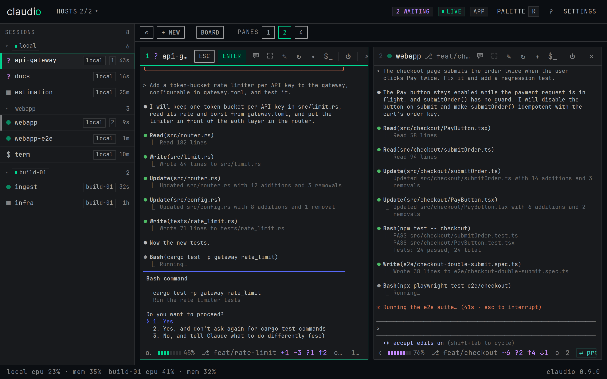
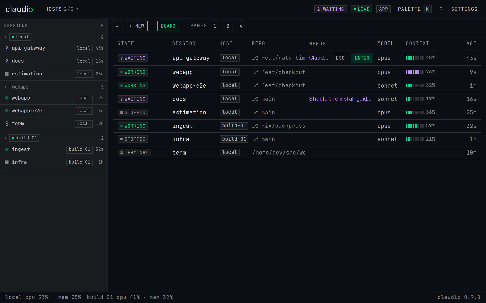
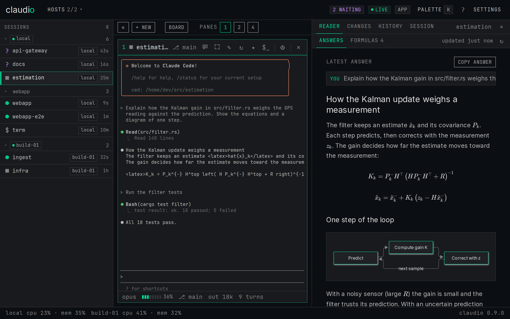
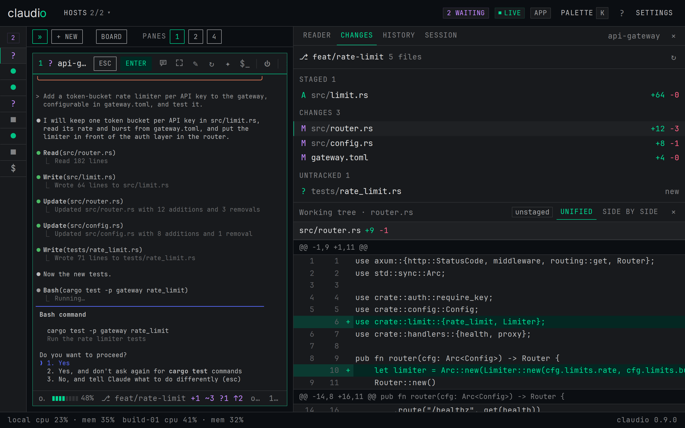
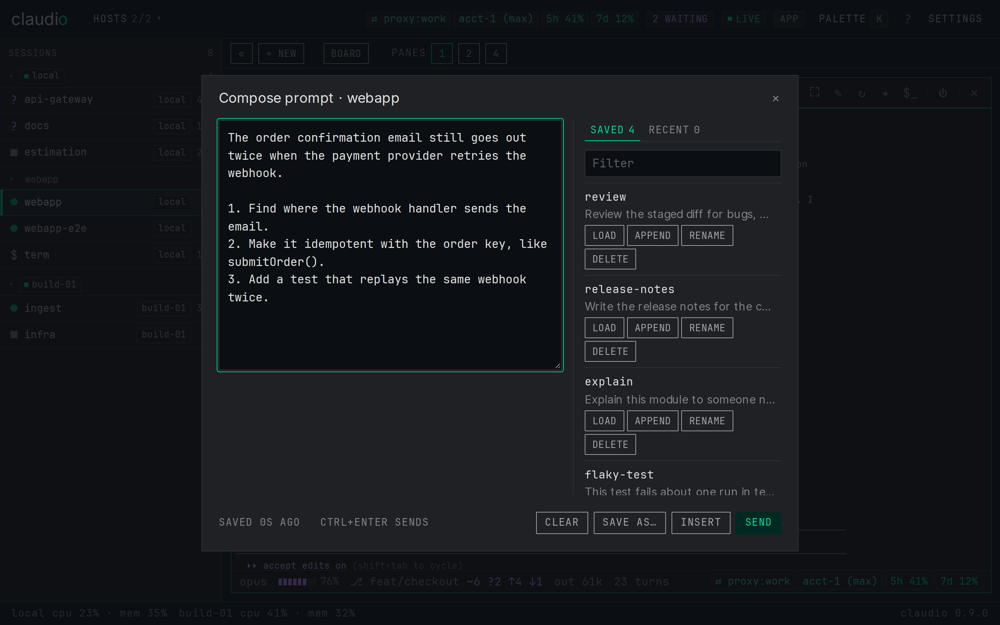
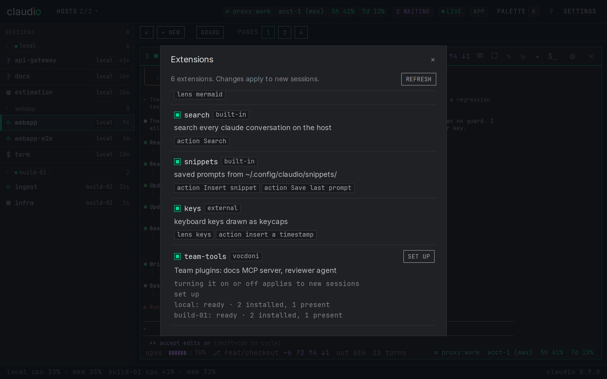
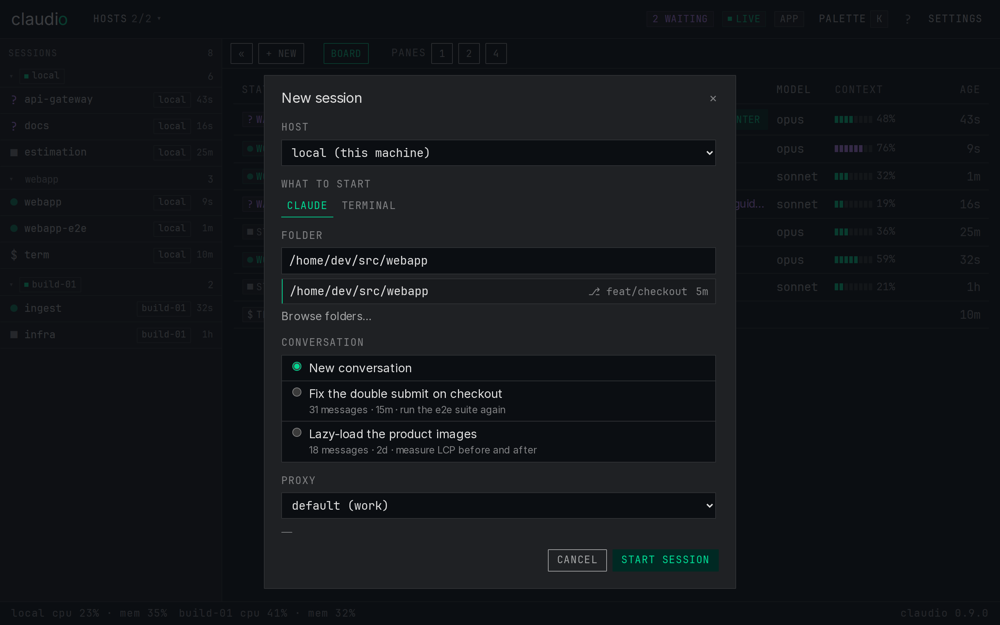
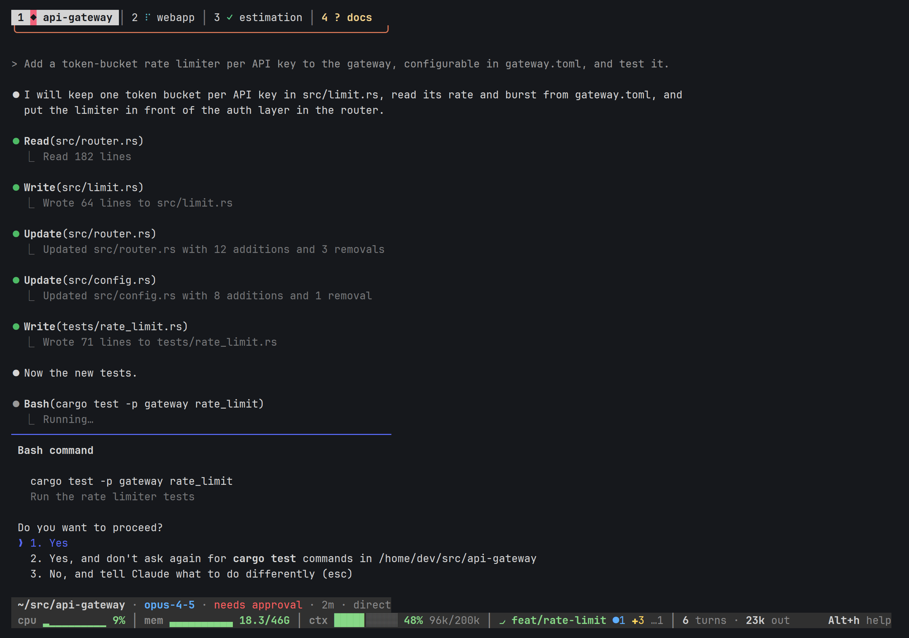
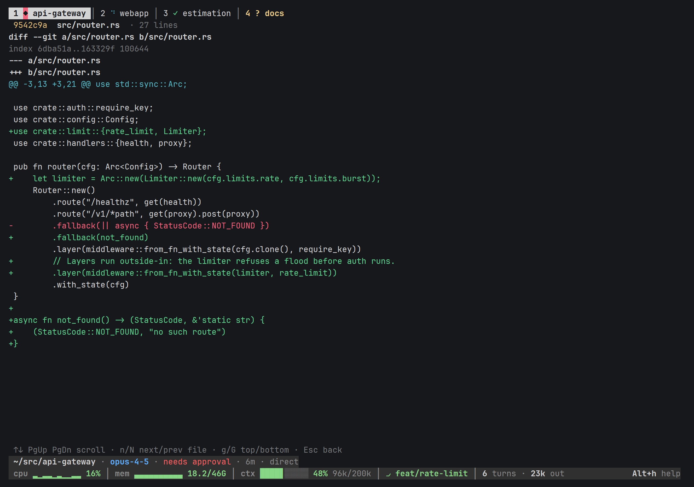
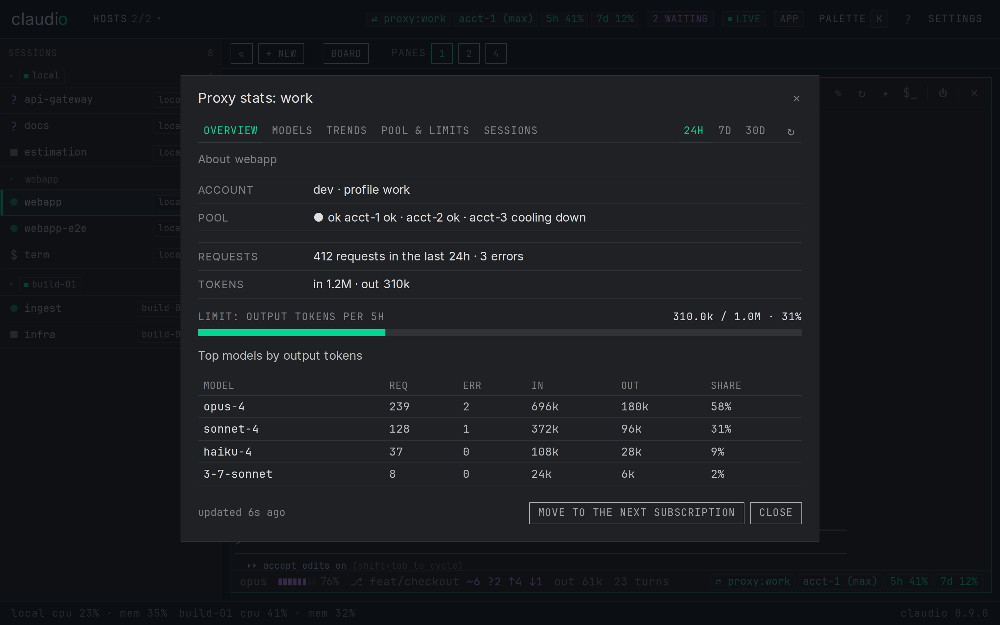

# claudio

Run many [Claude Code](https://claude.ai/claude-code) sessions, on this machine and on your SSH hosts, from a browser or a terminal. A small daemon on each host owns the sessions, so they keep running when you close the UI or lose the connection, and every window you open shows the same sessions. claudio drives the real `claude` with your own login; nothing about Claude Code changes.



*`claudio web`: every session on every host in the rail, two of them live in panes. The left one waits for a permission; Enter in its header approves it.*

---

## The web UI

```bash
claudio web          # serves http://127.0.0.1:7337 through the daemon and opens it in your browser
claudio web --app    # the same, in an app window of Chrome, Chromium, Brave or Edge
claudio web --install-launcher   # a "claudio" launcher in the desktop menu that runs claudio web --app
claudio web status   # is it running? (claudio web stop turns it off)
```

It prints `claudio web: http://127.0.0.1:7337/#t=<token>` and exits: the daemon keeps the web running, restarts it if it stops, and starts it again with the daemon (after a reboot, at the next `claudio`). `claudio web --foreground` serves from the terminal instead. The first visit trades the token for a cookie; later visits need nothing until the sign-in goes unused for 30 days, and closing the browser keeps it (the palette's Sign out ends it). The page is one more client of your daemons, like the terminal UI: the same sessions, hosts and `config.toml`. The page makes no external requests and runs under a strict CSP.



*The board (`Alt+g`): one row per session, with its state, host, branch, model and context. A waiting session says what it needs, and a permission prompt can be answered from its row.*



*The reader (`r` or `Alt+u`): claude's last answers from the transcript, as markdown, with formulas typeset by KaTeX and diagrams drawn by Mermaid. Formulas lists every formula of the conversation.*



*Changes (`g`): the session's working tree, staged, changed and untracked, and each file's diff, unified or side by side. History (`Alt+l`) browses the commits.*



*Compose (`Alt+o`): write a long prompt in an editor, then Insert it into claude's input or Send it. Saved prompts are the snippets in `~/.config/claudio/snippets/`.*



*Extensions (`Alt+i`): the built-ins, your own extensions and the addons' rows, each turned on or off. Here the Vocdoni addon's team plugins show what they installed on each host.*



*New session (`n` or `Alt+n`): pick a host and a folder, then start a new conversation or resume one from that folder. A terminal tab starts from the same dialog.*

Also: one, two or four panes, terminal tabs, search across every conversation (`/`), a command palette (`k`), desktop notifications, and the addons' panels (proxy stats, `Alt+s`).

**Keys.** The page has two modes, shown in the top bar. In TERM, focus is in a terminal and every key goes to the session, except `Ctrl+Shift+Space`, which leaves it. In APP, single keys drive the page (`k` palette, `n` new session, `a` next session that needs you, `?` help). The terminal UI's `Alt` keys work in both. In a normal browser tab the browser keeps `Ctrl+W`, `Ctrl+T` and `Ctrl+N`; install the page as an app, or use Capture all keys in Settings, to give them to the session. Details: [docs/web.md](docs/web.md).

### From another machine

By default (without `--remote`), `claudio web` listens on loopback only. Two ways to reach it from a laptop or a phone:

- **An SSH tunnel.** `ssh -L 7337:127.0.0.1:7337 host`, then open the URL `claudio web` printed on the host.
- **`--remote`.** Set a password once with `claudio web --set-password` (8 bytes or more), then run `claudio web --remote`. The daemon serves HTTPS on the network (port 7337 by default) with a self-signed certificate made on the first start and kept. `claudio web --remote` and `claudio web status` print the certificate's SHA-256 fingerprint: check it against the one your browser shows before you accept the certificate. Remote browsers sign in with the password; the token link works only from the machine itself. `claudio web --print-cert` prints the certificate, to install it as trusted on the devices you use.

The token, the password's hash and the certificate's key stay in `~/.config/claudio/` (mode 0600). Whoever has the token or the password can type into your sessions. The security model is in [docs/web.md](docs/web.md).

---

## The terminal UI

A bare `claudio` opens the same sessions in your terminal: one tab per session, claude's own screen in the pane, and a two-line status bar.



*Four sessions. The tab glyphs say working (`⠏`), waiting for approval (`◆`), waiting for input (`?`) and idle (`✓`). The status bar shows the directory, model and state, then the host's CPU and memory, the context gauge, the git tree and the conversation's totals.*



*`Alt+l`: the read-only git viewer, here on a commit's patch.*

Only `Alt` keys are claudio's; everything else goes to Claude Code. `Alt+h` lists them, and `[keys]` in `config.toml` rebinds them.

| Key | Action |
|---|---|
| `Alt+←` / `Alt+→` | Previous / next session |
| `Alt+Shift+1`…`9`, `0` | Go to session 1…10 (terminals with the kitty keyboard protocol) |
| `Alt+n` | New session (wizard) |
| `Alt+c` | Terminal tab next to this one, in the session's directory |
| `Alt+a` | Next session that needs you |
| `Alt+g` | Overview of all sessions |
| `Alt+l` | Git history: log, commit, patch |
| `Alt+u` | Reader: the session's last answers as markdown |
| `Alt+e` | Restart the session: resume the conversation or start a new one |
| `Alt+r` / `Alt+x` | Rename / close (asks first) |
| `Alt+z` | Extension actions: `s` search, `p` insert a snippet, `P` save the last prompt, and your own |
| `Alt+i` | Extensions screen: turn each one on or off |
| `Alt+s` | The addon panel (the Vocdoni addon's proxy stats) |
| `Alt+h` | Help |
| `Alt+q` | Quit the UI; sessions keep running |

Background sessions that need you get a coloured tab and a desktop notification (OSC 9). Dragging in a session selects text and copies it (OSC 52). When claude exits cleanly (`/exit`), its tab closes.

The terminal UI shows claude's screen exactly as claude drew it. Formulas and diagrams render in the web UI only; the console reader shows their source.

`claudio --plain [claude args…]` is one full-screen claude session with claudio's keys and launch options, no tabs and no saved state. It exits when claude does, with claude's exit status.

---

## Install

```bash
curl -fsSL https://github.com/p4u/claudio/releases/latest/download/install.sh | bash
```

| Variable | Default | Description |
|---|---|---|
| `CLAUDIO_VERSION` | latest | A release tag, e.g. `v0.9.0` |
| `CLAUDIO_INSTALL_DIR` | `~/.local/bin` | Where to put the `claudio` binary |

Linux and macOS, x86\_64 and arm64. `~/.local/bin` must be on your `PATH`. Don't install claudio *as* `claude`: it runs the real `claude` it finds on `PATH` (or `$CLAUDIO_CLAUDE_PATH`).

`claudio upgrade` replaces the binary with the latest release (`--check` only checks). The status bar shows `↑ vX.Y.Z` when one exists; the check runs at most once a day and `CLAUDIO_NO_UPDATE_CHECK=1` or `[update] check = false` turns it off.

## Quick start

You need a Claude Code account. If `claude` is missing, claudio installs it with the official installer; you log in the first time it starts.

1. Run `claudio web` (or `claudio` for the terminal UI).
2. The new-session dialog opens. Pick a recent folder or browse to one. For an SSH host, pick it as the host (in the web UI, add it from the Hosts menu first).
3. Start a new conversation or resume one from that folder.
4. Close the browser tab or quit with `Alt+q`. The sessions keep running; open either UI again and they are where you left them.

**SSH hosts.** Hosts come from `~/.ssh/config`, the ones you used before, or a name or `user@host` you type (Alt+n, the web's hosts panel). Key-based `ssh <host>` must work without a password. A host's key is recorded at its first connection and a changed key is refused (`StrictHostKeyChecking=accept-new` on ssh's command line, whatever your ssh config sets). claudio copies itself to `~/.local/bin/claudio` on the host, keeps it in sync by checksum, and starts a daemon there (under `systemd-run --user` when it can). No remote dotfiles are touched. The daemon finds claude through your login shell's `PATH`; `CLAUDIO_CLAUDE_PATH` pins one, and `claudio daemon status` shows which one a host uses. To use your SSH keys from sessions on a host (`git push`, `ssh` onward), turn on agent forwarding for it: `Alt+f` on the host in Alt+n, or the host panel in the web ([docs/web.md](docs/web.md#ssh-hosts) says what that lets the host do).

**Keeping claude current.** Once a day claudio compares `claude --version` with the latest release and asks before running `claude update`; an SSH host with an older claude than yours gets the same offer. Running sessions keep their binary. claudio starts claude with `--allow-dangerously-skip-permissions` when claude supports it, so bypass mode is one `Shift+Tab` away; claude never starts in it (`allow_skip_permissions = false` turns this off).

---

## Core and addons

claudio is a generic **core** plus **addons** compiled into the same binary. The core is the daemon, SSH hosts, the terminal UI, `--plain`, the claude installer and the passthrough: with no `-p` and no claudio word, `claudio …` runs the real `claude …` unchanged. Each addon is a cargo feature, all on in a release:

| Addon | Feature | What it adds |
|---|---|---|
| Web | `web` | `claudio web`, the browser UI, and the formula and diagram rendering |
| API | `api` | `claudio -p`, a drop-in for `claude -p`, and `claudio --api`, an OpenAI-compatible server |
| Vocdoni | `vocdoni` | `claudio vocdoni …`: the [claude-proxy](https://github.com/p4u/claude-proxy) client and the team plugins |

A build with no addons (`cargo build --no-default-features`) is the core alone and works with a plain `claude` login. A build without the API addon refuses `-p`, `--print` and `--api` with exit 2; claudio never runs `claude -p`. How addons plug in: [docs/addons.md](docs/addons.md).

### The Vocdoni addon: claude-proxy and team plugins

[claude-proxy](https://github.com/p4u/claude-proxy) shares a pool of Claude subscriptions; sessions authenticate through it instead of a local `claude` login. The Vocdoni addon is its client.

```bash
claudio vocdoni login                            # sign in to https://claude.vocdoni.net in the browser
claudio vocdoni login https://proxy.example.com  # or to another claude-proxy
```

The sign-in shows a page and a one-time code; the proxy then hands claudio your own token, saved with your e-mail in a profile in `config.toml` (mode 0600). `--token` pastes a token instead (from stdin when it is not a terminal). `claudio vocdoni status|use|logout` manage profiles, and `claudio proxy …` is an alias.

New sessions use the default profile. `--proxy NAME`, `--no-proxy` and `--first-party` override it for one run (`claudio --no-proxy`, `claudio --plain --proxy work`); the new-session dialog has the same choices. A proxy session's credential and its 5-hour and 7-day windows show in the status bar, and `Alt+s` opens the proxy stats:



*The Vocdoni addon's panel: usage, the pool, your limit and the top models, with an action to move the session to the next subscription.*

When a proxy session's turn ends on a subscription limit ("You've hit your 5-hour limit"), the daemon on its host asks the proxy to move the conversation to another subscription and types `continue`, at most 3 times in a row; a notice says what happened, and a direct session is left alone. `auto_switch = false` under `[proxy]` in that host's `config.toml` turns it off.

The proxy can also serve **plugins**: a pinned, hash-checked manifest of Claude Code plugins, MCP servers (their secrets come as env), subagents and instructions for every session. The first time claudio sees one it asks what to install; each host's daemon then installs the plugins with `claude plugin install` (never with `-y`), and every session on that proxy profile gets the servers, agents and instructions. What you already have is left alone. The extensions screen shows each plugin's state per host.

Two ways to run through the proxy:

- **Gateway mode** (the default): `ANTHROPIC_BASE_URL` points at the proxy, with `CLAUDE_CODE_USE_GATEWAY=1` and `CLAUDE_CODE_DISABLE_NONESSENTIAL_TRAFFIC=1`. Claude Code then turns its feature flags off, so Monitor, `/advisor`, WebSearch and PushNotification are unavailable.
- **First-party mode** (`--first-party` for one run, or `first_party = true` under `[proxy.profiles.<name>]`): the gateway variables are left out, so the flag-gated features work (WebSearch only if the proxy passes Anthropic's web search tool through). The cost: Claude Code's telemetry and feature-flag requests also reach api.anthropic.com. A restarted or restored session keeps its mode.

An exported `CLAUDE_CODE_DISABLE_NONESSENTIAL_TRAFFIC` is kept and turns the feature flags off even in first-party mode; unset it for those sessions. `CLAUDIO_PROXY_URL=<token>@proxy.example.com claudio` uses a proxy for one run without saving a profile.

### Print mode and the API server

`claudio -p "…"` behaves like `claude -p` but drives the interactive Claude Code UI under a PTY and reads the answer and the real token usage from the session transcript. `claudio --api` serves an OpenAI-compatible API on the same backend, with a pool of live sessions, for clients such as pi, opencode and hermes. See [docs/print-and-api.md](docs/print-and-api.md).

---

## Commands

| Command | What it does |
|---|---|
| `claudio [--proxy NAME\|--no-proxy] [--first-party]` | The terminal UI |
| `claudio web [--listen ADDR] [--no-open]` | The web UI, served by the daemon (also `stop`, `status`, `--foreground`, `--remote`, `--set-password`, `--print-cert`, `--print-url`, `--rotate-token`, `--app`, `--app=URL`, `--install-launcher`, `--remove-launcher`) |
| `claudio --plain [claude args…]` | One full-screen claude session |
| `claudio sessions` | List the local sessions as a table |
| `claudio daemon status\|stop\|restart` | Inspect or control this host's daemon |
| `claudio upgrade [--check]` | Install the latest release, or only check |
| `claudio vocdoni login\|status\|use\|logout` | Proxy profiles (Vocdoni addon; `claudio proxy …` is an alias) |
| `claudio -p "…"` | Drop-in for `claude -p` (API addon) |
| `claudio --api` | OpenAI-compatible API server (API addon) |
| `claudio <anything else>` | Runs the real `claude` with the same arguments |

## Configuration

Everything lives in `~/.config/claudio/`. `config.toml` is optional:

```toml
[ui]
notify = true                   # desktop notifications for sessions that need you
copy_on_select = true           # drag in a session to select and copy (OSC 52)

[update]
check = true                    # check for new claudio releases

[claude]
allow_skip_permissions = true   # start claude with --allow-dangerously-skip-permissions
update_check = "ask"            # this machine's claude vs its release channel: "ask" | "auto" | "off"
remote_check = "ask"            # SSH hosts' claude vs this machine's: "ask" | "auto" | "off"
install = "auto"                # install claude where a host has none: "auto" | "ask" | "off"

[ssh]
forward_agent = ["devbox"]      # hosts whose connection forwards your ssh agent (Alt+f in Alt+n)

[extensions]                    # every extension is on unless turned off here
diagram = false                 # e.g. no Mermaid instruction or drawing (Alt+i writes this table)

[keys]                          # rebind any terminal UI key
new_session = "alt+n"
git_log     = "alt+l"
formulas    = "alt+u"           # the reader
```

The `[proxy]` and `[plugins.*]` tables belong to the Vocdoni addon. Snippets are files in `snippets/`; your own extensions are directories in `extensions/` ([docs/extensions.md](docs/extensions.md), example in [`examples/extensions/keys/`](examples/extensions/keys/)). `CLAUDIO_NO_UPDATE_CHECK=1` turns off the claudio and claude release checks, and `CLAUDIO_NO_BROWSER=1` keeps claudio from opening a browser.

## Building from source

```bash
make                 # release build: target/release/claudio
make static          # static musl binary: dist/claudio (ARCH=aarch64 to cross-build)
make install         # build static, install to ~/.local/bin, restart a running daemon
make check           # the acceptance checks: fmt, clippy, rules, core-only build, unit tests
make matrix          # build and test the core alone, each addon alone, and all of them
cargo build --no-default-features                    # the core alone
cargo build --release --no-default-features --features web,vocdoni   # pick addons
```

The source is a Cargo workspace:

```
src/main.rs        the binary: routes argv to the core or an addon
crates/core        claudio-core: daemon, SSH, protocol, the addon API, the shared app layer
crates/tui         claudio-tui: the terminal UI and --plain
addons/web         claudio-web: the server (src/) and the page (web/, no build step)
addons/api         claudio-api: -p and --api
addons/vocdoni     claudio-vocdoni: the claude-proxy client and team plugins
```

Every change meets [ACCEPTANCE.md](ACCEPTANCE.md). The web UI follows [DESIGN.md](DESIGN.md). Test suites and their gates are in [CLAUDE.md](CLAUDE.md#commands).

## Documentation

- [docs/web.md](docs/web.md): the web UI, its keys and its security model
- [docs/addons.md](docs/addons.md): the addon API and the three addons
- [docs/extensions.md](docs/extensions.md): writing your own extensions
- [docs/print-and-api.md](docs/print-and-api.md): `-p`, `--api`, env vars and client setups
- [docs/web-protocol.md](docs/web-protocol.md): the protocol between the web server and the page
- [docs/daemon-protocol.md](docs/daemon-protocol.md): the daemon's wire protocol
- [docs/manager-design.md](docs/manager-design.md): the session manager's design

<!-- Screenshots: the web ones from addons/web/web/dev/mock-server.mjs with demo fixtures, 1440x900 at 2x;
     the terminal ones from a debug build with a fake claude in an isolated HOME, rendered with xterm.js. -->

## Maintainer

Bump the version in `Cargo.toml`, tag `vX.Y.Z` and push the tag. The release workflow publishes the binaries to this repo.
