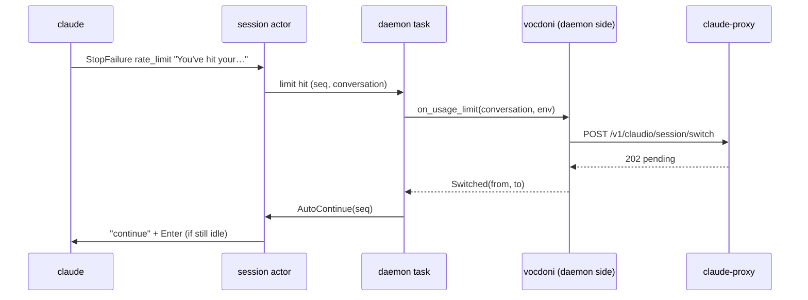

# Switch subscription and continue when a session hits a usage limit: design

Status: audited (2026-11-12; audit-spec.md F1-F11 folded in)   Class: architectural (addon API change; claudio types into sessions unasked)
Owner decisions so far (2026-11-12):
- Proxy sessions only. Direct sessions, with nothing to switch to, stay as today.
- At most 3 automatic switch-and-continue attempts in a row per session. The count resets when a
  turn ends normally. claudio stops at once when the proxy has no other subscription.
- On by default. `[proxy] auto_switch = false` in `config.toml` turns it off, read by the daemon
  on each host.

## Problem

- A long session that hits a subscription limit stops with claude's message, for example
  "You've hit your 5-hour limit · resets 4pm (UTC)". It stays stopped until someone notices.
- claude-proxy pins each conversation to one subscription. When that one is rate-limited it passes
  the 429 through instead of moving the conversation (claude-proxy README, "Sticky binding": the
  `limited` row). Other subscriptions in the pool sit unused for this session until a person opens
  the Proxy stats panel (Alt+s) and runs "switch", then types "continue".

## Goals

1. When a proxy session's turn ends on a usage limit, the daemon of that session's host does two
   things without any client attached. It asks the proxy to move the conversation to another
   subscription. If that is accepted, it types `continue` and Enter into the session.
2. Never a loop. At most 3 consecutive attempts per session; the count resets on a turn that ends
   normally (`Stop`). Never when the proxy has no alternative. Never when someone typed into the
   session since their last submitted prompt. One attempt in flight per session.
3. Clients see what happened: a session notice on every attempt (switched, continuing n/3; switch
   failed; gave up after 3).
4. Exactly once per limit hit, whatever the number of connected TUIs and browsers.

## Non-goals

- Direct (non-proxy) sessions: no waiting for the reset, no account switching.
- Other `StopFailure` errors (overloaded, authentication) and the proxy's own per-user limit (its
  429 text is "proxy: usage limit reached …", not "You've hit your").
- A new UI control. The config key is the switch.
- Changes to claude-proxy. `POST /v1/claudio/session/switch` already exists.
- Any change to the daemon wire protocol or the web protocol. Existing `Notice` events carry the
  messages.

## Current state

- claude's `StopFailure` hook fires instead of `Stop` when an API error ends a turn. Its input has
  `error` (`"rate_limit"`, `"overloaded"`, `"authentication_failed"`, …), `error_details`
  (optional) and `last_assistant_message` (optional). For a usage limit the message is the text
  claude shows: `You've hit your 5-hour limit · resets 4pm (UTC)`.
  - Verified in the installed claude 2.1.322: the hook's schema, and transcripts with
    `"error":"rate_limit"`, `"apiError":"usage_limit_reached"`, and that text.
  - The common subscription variants start with `You've hit your`. Credit and org variants use
    the other prefixes of claude's own `usage_limit_reached` classifier: `You've reached your`,
    `You're out of usage credits`, `Your org is out of usage`,
    `Your seat type doesn't include usage`, `You're out of extra usage`.
  - The proxy's own per-user 429 reaches claude as `API Error: 429 proxy: usage limit reached …`
    and matches none of these.
- The daemon already subscribes to `StopFailure` (`claude::hooks::EVENTS`,
  crates/core/src/claude/hooks.rs:27-36). The session actor's `on_hook`
  (crates/core/src/daemon/session.rs:931-947) runs the state tracker, which turns it into
  `SessionState::Error` (claude/state.rs:82). The payload is otherwise unused.
- The actor writes input with `write` (session.rs:949-953; `Cmd::Input`, session.rs:86,820),
  verbatim and without delay. It broadcasts notices as `SessionEvent::Notice { text }`
  (session.rs:976-981).
- The only code that types into interactive claude today, the api addon's driver
  (addons/api/src/print/driver.rs:617-626), dwells at least 50 ms after the text before a
  separate `\r` write: "Enter too early drops the just-typed text".
- The daemon keeps each journaled session's last spawn env in memory:
  `Registry.session_env: HashMap<SessionId, admit::SessionEnv>` (daemon/mod.rs:292). Its `Debug`
  shows keys only (admit.rs:17-30). The conversation id comes from the tracker
  (`claude_session_id`, recorded by `record_claude_session`, daemon/mod.rs:714).
- The vocdoni addon routes a proxy session by putting `ANTHROPIC_BASE_URL` (the profile URL) and
  `ANTHROPIC_AUTH_TOKEN` (the profile token) in the spawn env (addons/vocdoni/src/proxy/env.rs:57-58).
- The addon already switches a session from the front-end: `panel::action`
  (addons/vocdoni/src/panel/mod.rs:250-287) calls
  `proxy::api::switch_session(url, token, conversation)` (api.rs:466).
  - 202 means pending: the move applies to the conversation's next request.
  - 409 `no_alternative` (`SwitchError::NoAlternative(reason)`) means no other eligible
    subscription, or the session is account-bound. The proxy says which.
  - 404 means unknown session.
- Addon daemon side: `DaemonOps` (crates/core/src/addon/daemon.rs:15-35) has `handle` (ops),
  `on_claude_installed` and `service`. Vocdoni implements it in addons/vocdoni/src/daemon/ops.rs:84.
  Vocdoni declares the config sections `proxy` and `plugins` (addons/vocdoni/src/lib.rs:73-75).
- `DaemonCtx` (addon/daemon.rs:68-87) has no config accessor. Only the service supervisor reads
  config daemon-side (daemon/service.rs:305-323). The front-end's `AddonCtx::config(section)`
  (addon/mod.rs:109) is the model to mirror.
- Slow work never runs inline in the daemon's request loop or an actor; it is spawned (CLAUDE.md,
  "Daemon").

## Design



### 1. Detection (core, session actor)

- `on_hook("StopFailure", payload)` counts as a usage-limit hit only when both hold:
  - `payload.error == "rate_limit"`;
  - `payload.last_assistant_message`, trimmed, starts with one of claude's own usage-limit
    prefixes: `You've hit your`, `You've reached your`, `You're out of usage credits`,
    `Your org is out of usage`, `Your seat type doesn't include usage`,
    `You're out of extra usage`.

  The prefixes are a `const` slice in `claude::hooks`, documented as claude 2.1.322's
  `usage_limit_reached` list. The check is a pure predicate,
  `claude::hooks::is_usage_limit(&Value) -> bool`, unit-tested.
- The actor keeps:
  - `limit_seq: u64`, raised on every hit;
  - `auto_continues: u8`, consecutive attempts;
  - `auto_pending: bool`, an attempt in flight;
  - `input_since_prompt: bool`.
- A `Stop` hook resets `auto_continues` to 0.
- Client input to the session (`Cmd::Input` from a client, never the daemon's own writes) sets
  `input_since_prompt`. `UserPromptSubmit` clears it, because the typed text became the turn's
  prompt. A hit never clears it: input typed during the failing turn still blocks the attempt,
  because it may sit in claude's input box.
- On a hit with `auto_pending == false`:
  - with `auto_continues >= 3`, it broadcasts the give-up notice and does nothing else;
  - otherwise it sets `auto_pending` and spawns the attempt (§2) with `(limit_seq, conversation
    id)`.
- There is no conversation id yet: nothing happens.

### 2. The attempt (core, spawned task; addon API)

- New `DaemonOps` method, default `NotMine`:

  ```rust
  fn on_usage_limit<'a>(&'a self, hit: UsageLimit<'a>, ctx: Arc<dyn DaemonCtx>)
      -> BoxFuture<'a, LimitOutcome>;

  pub struct UsageLimit<'a> {
      pub conversation: &'a str,              // claude's session id
      pub message: &'a str,                   // sanitized, ≤ 256 bytes
      pub env: &'a (dyn Fn(&str) -> Option<String> + Sync), // the session's spawn env, by name
  }
  pub enum LimitOutcome {
      NotMine,                                 // not this addon's session, or switched off
      Switched { from: String, to: String },   // the next message goes elsewhere
      Failed(String),                          // tried; why it did not work
  }
  ```

- New defaulted `DaemonCtx` method, mirroring the front-end's `AddonCtx::config`:
  `fn config(&self, section: &str) -> toml::Table { toml::Table::new() }`.
  - The daemon's `Ctx` re-reads `Config::config_file` on each call, with the service
    supervisor's size cap.
  - It returns the section only when the asking addon declares it, and an empty table otherwise.
  - Because it re-reads on each call, `[proxy] auto_switch = false` takes effect at the next
    attempt without a daemon restart.
- The task reads the session's spawn env from `Registry.session_env` (a copy, outside the lock).
  It asks each daemon-side addon in registry order and takes the first answer that is not
  `NotMine`.
- The whole attempt has a budget, `Config::limit_attempt_timeout` (default 20 s, so tests can
  shorten it). Past it the result is `Failed("timed out")`.
- The actor captures its own `tx` into the task. The task reports with one
  `Cmd::LimitDone { seq, outcome }`, which also clears `auto_pending`. The actor broadcasts every
  notice.
  - After a respawn the old channel is closed and the report is dropped, so it never reaches a
    new actor.
  - The addon future runs under `tokio::spawn`. A `JoinError` (a panic) becomes
    `Failed("addon panicked")`, so `auto_pending` is always cleared.
- Every string an addon returns goes through the runtime's `addon/clean.rs` rules (sanitize, one
  line, ≤ 120 bytes) before a notice uses it. The env reaches addons only through this call and is
  never logged.
- The outcomes:
  - **`Switched`:** after a 1 s settle, the actor types `continue` only if all of these hold:
    - `seq == limit_seq` (no newer hit);
    - the state is still `Error`;
    - `input_since_prompt` is false;
    - the process is alive.

    After a 150 ms dwell it writes `\r` as a separate PTY write, if `seq` is unchanged. This
    mirrors the api driver's text-dwell-Enter sequence. The settle and the dwell are timers that
    send `Cmd`s back to the actor, never a blocking sleep on it. The actor then raises
    `auto_continues` and broadcasts `usage limit: switched {from} → {to}, continuing ({n}/3)`.

    If any condition fails it writes nothing and broadcasts
    `usage limit: switch to {to} scheduled; not continuing automatically`. The proxy move still
    applies to the session's next message, and the notice says so.
  - **`Failed(why)`:** broadcast `usage limit: could not switch subscription: {why}`. Nothing is
    typed.
  - **`NotMine` from every addon:** nothing. A direct session stays as today.
  - A hit that arrives while an attempt is in flight broadcasts nothing then; the pending
    attempt's outcome notice covers it.
- The give-up notice is `usage limit: 3 automatic switches in a row; continue by hand`.

### 3. Vocdoni's `on_usage_limit` (addon)

1. Read `[proxy] auto_switch` from the daemon host's `config.toml`, through the addon API (its own
   declared section only; a bool, default `true`). `false` → `NotMine`.
2. Take `ANTHROPIC_BASE_URL` and `ANTHROPIC_AUTH_TOKEN` from `hit.env`. Either missing or empty →
   `NotMine`.
3. Call `proxy::api::switch_session(base_url, token, conversation)` with a 15 s timeout.
   - 202 → `Switched { from: from.name() or "current subscription", to: to.name() or "next
     available" }`.
   - 409 → `Failed(<SwitchError::NoAlternative's reason>)`, the proxy's own message: "no other
     eligible credential can serve this session", or the account-bound explanation.
   - 404 → `Failed("the proxy does not know this session")`.
   - Others → `Failed(<the existing SwitchError text>)`.
4. The token is never logged or put in a notice.

### Alternatives considered

| Option | Why not |
|---|---|
| Front-end side, reusing `panel::action` | Needs a TUI or browser connected; two connected front-ends would switch and type twice; a remote host's sessions would depend on the laptop being awake. |
| Match the text on the screen | Fragile (Ink redraws, wrapping). The hook carries the same text, already parsed. |
| Read the transcript's `apiError`/`resetsAt` | Needs a transcript read per failure. The hook is synchronous with the event and already relayed. |
| Pass the route (addon, profile) in `SpawnSpec` | A protocol change for what the env already says. |
| Pass `[proxy] auto_switch` per spawn from the front-end | A protocol field. Each host's daemon reading its own config was the owner's choice. |
| Proxy retries the 429 on another credential itself | Changes claude-proxy's passthrough semantics for every client, and the turn's partial state and claude's own retry and backoff assume the 429 reaches it. Ruled out by "no proxy changes" (Non-goals); revisit if the claudio-side loop proves fragile. |

## Compatibility and rollout

- **No wire change.** Old clients show the notices as they show any `Notice`.
- **Old daemon:** no auto-switch (the feature lives in the daemon). Docs say a host gets it when
  its daemon is from this release.
- **Old claude without `StopFailure`:** the hook never fires, so the feature does nothing; the
  daemon already registers it.
- **Addon API:** two defaulted trait methods (`DaemonOps::on_usage_limit`, `DaemonCtx::config`),
  so other addons, `TestAddon` and any test `DaemonCtx` compile unchanged. docs/addons.md
  documents them first.
- **Rollback:** `[proxy] auto_switch = false` on the host, or downgrade.

## Failure modes and security

- **Loops:** bounded by the 3-in-a-row cap, the seq and idle checks, a single attempt in flight,
  and 409 stopping at once. A limit that recurs only after a successful turn resets the count by
  design (owner decision).
- **Typing into a session unasked:** only `continue`, then Enter, only while the session sits in
  `Error` after this very failure, and only if no one typed since their last submitted prompt.
  Claude's input box is empty after a failed turn unless someone typed since then, which the
  check covers.
- **Untrusted strings:** the proxy's subscription names and claude's message are sanitized and
  capped before any notice.
- **Secrets (C1):** the token is read from the session env in memory, sent only to the session's
  own proxy URL (the URL the session already talks to), and never logged. `UsageLimit` has no
  `Debug` that prints env values.
- **Timeouts:** 15 s per HTTP call and 20 s per attempt, both off the actor and the request loop.
- **Restarts:** counters live in the actor. A respawned session starts at 0.
- **Concurrency:** the task never holds the registry lock across awaits. The actor alone decides
  to type.

## Acceptance criteria

- [ ] AC1: unit tests of `is_usage_limit`:
  - true for `rate_limit` with each message variant seen in claude 2.1.322 (5-hour, weekly, Opus,
    monthly spend, team budget) and with one message per other prefix;
  - false for `overloaded`, for `rate_limit` with "API Error: 429 proxy: usage limit…", for a
    missing message, and for a non-string.
- [ ] AC2: daemon tests with a `TestAddon` implementing `on_usage_limit` and a fake claude that
  fires `StopFailure` and records its input:
  - **Switched:** `continue` and then a separate `\r` are written once, with the notice "(1/3)".
  - **Repeated:** four hits without a `Stop` produce exactly 3 continues and then, on the fourth
    hit, the give-up notice. A `Stop` resets the count.
  - **Failed:** a notice, nothing typed.
  - **NotMine:** nothing typed, no notice.
  - **Client input:** typed before the hit (during the turn) or between the hit and the settle,
    nothing is typed and the "scheduled; not continuing" notice is shown. After a
    `UserPromptSubmit` the guard is clear again.
  - **A second hit while an attempt is in flight:** no second attempt.
  - **Timeout:** past `limit_attempt_timeout` (shortened in the test), a `Failed` notice.
  - **Panic:** an addon future that panics gives `Failed("addon panicked")`, and the next hit
    can attempt again.
  - **Two clients:** one case runs with two subscribed test clients and asserts a single
    `continue` write.
- [ ] AC3: vocdoni unit tests against a stub proxy (the existing `switch_router`):
  - 202 → `Switched` with names;
  - 409 → `Failed` carrying the stub's reason text;
  - `auto_switch = false` → `NotMine`, with no request sent;
  - env without base URL or token → `NotMine`, with no request sent;
  - the request carries the session's conversation and token.
- [ ] AC4: an integration test in the `vocdoni_manager` suite (fake claude and fake proxy).
  - A proxy session whose fake claude emits a usage-limit `StopFailure` gets a switch request at
    the fake proxy and then receives `continue` (the fake claude echoes its input to the screen).
  - The TUI shows the notice.
- [ ] AC6 (opt-in, `CLAUDIO_E2E=1`): against a real interactive claude, the daemon's
  type-dwell-Enter path delivers a prompt that starts a turn: a `UserPromptSubmit` follows. The
  sequence is triggered through a test-only daemon hook, never a real limit. Skipped runs report
  it.
- [ ] AC5: docs updated:
  - docs/addons.md (the new method, first);
  - docs/manager-design.md (the auto-switch);
  - the vocdoni docs where `[proxy]` keys are listed (`auto_switch`);
  - CLAUDE.md (one clause).

  `make check`, `make matrix`, the manager, vocdoni_manager and web suites pass.

## Constraints

- ACCEPTANCE.md throughout:
  - A2/A3: the core never names vocdoni or the proxy; detection and typing are generic, and the
    switch is the addon's.
  - A8: size baselines.
  - A10: bounded.
  - C1: no token in logs or notices.
  - C2: sanitize addon strings.
  - E2: no weakened tests.
- Slow work is spawned: never inline in the actor or the request loop.
- Tests are hermetic: fake claude, fake proxy, the suites' isolated env. Never touch the owner's
  daemon or proxy.
- Linux and macOS.
- Commits: `type(scope): lowercase summary`, no AI attribution or Co-Authored-By trailers.

## Open questions

None.
