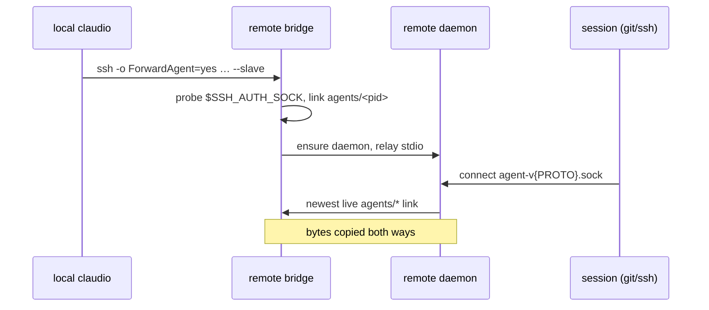

# SSH agent forwarding per remote host: design

Status: audited (2026-11-12; audit-spec.md F1-F10 folded in)   Class: architectural (security-sensitive: delegates the use of the owner's SSH keys)
Owner decisions so far (2026-11-12):
- The option is per host, stored in `config.toml`, and toggled from the web (host panel, Alt+n's
  "Another host…", the add-host form) and from the TUI wizard's Where step.
- With the option off, claudio passes nothing about forwarding: `~/.ssh/config` decides, as today.

## Problem

- A remote host cannot use the owner's SSH keys. Sessions there cannot `git push` to a private
  remote or `ssh` onward. `ssh -A` (agent forwarding) is the usual answer.
- claudio's ssh command line (`remote::ssh_cmd`, crates/core/src/remote/mod.rs:41) never asks
  for forwarding. A host gets it only through `ForwardAgent yes` in `~/.ssh/config`, and many
  machines have no such file (v0.9.2's bug report).
- Even with `ForwardAgent yes`, forwarding does not reach claude sessions reliably. sshd creates
  the forwarded socket (`/tmp/ssh-XXXX/agent.N`) for one connection and removes it when that
  connection ends. The remote daemon is started once by a bridge (`claudio --slave`,
  crates/core/src/remote/bridge.rs:63) and outlives it. Every session inherits the daemon's env
  (crates/core/src/daemon/command.rs:80-97), which depends on how the daemon was started:
  - A daemon started by fork+setsid keeps the starting connection's `SSH_AUTH_SOCK`, which dies
    with that connection.
  - A daemon started by `systemd-run --user` (bridge.rs, the preferred path) runs in the user
    manager's environment and usually has no `SSH_AUTH_SOCK` at all.

  Either way, sessions outlive connections by design, so the agent stops working, or never
  works, for them.

## Goals

1. A per-host option, `[ssh] forward_agent`, a list of host strings exactly as connected
   (`"devbox"`, `"me@10.0.0.2"`). For a listed host, the ssh that carries the bridge passes
   `-o ForwardAgent=yes`.
2. On the remote host, every claude session and terminal can use a forwarded agent for as long as
   at least one forwarding connection to that host is up, whichever connection started it. A
   reconnect restores it without restarting the session.
3. The option is visible and switchable:
   - in the web's host panel, the add-host form and the wizard's "Another host…";
   - in the TUI wizard's Where step.

   Switching it for a connected host reconnects that host. Its sessions keep running, and the UIs
   re-attach as after a dropped connection.
4. Nothing changes for hosts without the option and without `ForwardAgent` in the ssh config, nor
   for the local host.

## Non-goals

- Managing keys or agents: no `ssh-add`, no key confirmation UI, no agent of claudio's own.
- Forwarding during bootstrap (probe and upload). Only the bridge's ssh forwards.
- Forcing `ForwardAgent=no` when the option is off (owner decision).
- Forwarding to the local host's sessions, and anything for the API addon's `-p`/`--api`.
- Making sessions started before a forwarded agent existed pick it up without a restart.

## Current state

- `remote::ssh_cmd(host)` (crates/core/src/remote/mod.rs:41-58) builds
  `ssh -T -o BatchMode=yes -o ConnectTimeout=15 -o ServerAliveInterval=15 -o ServerAliveCountMax=3
  -o StrictHostKeyChecking=accept-new -- HOST`. It is used by bootstrap
  (bootstrap.rs:167,240,383,468) and by the bridge connect `client::connect_ssh_with`
  (client.rs:224-233), which appends `"$HOME"/.local/bin/claudio --slave`.
- Both front-ends connect through the core:
  - TUI: `hosts.rs:205-260` `do_connect` → `ensure_remote` → `client::connect_ssh`.
  - Web: `hub_io.rs:29-53` `connect_once` → `ensure_remote` → `client::connect_ssh_reporting`.
- Both front-ends have a reconnect that keeps sessions:
  - TUI: `HostEvent::Reconnect` (lib.rs:646-659) does `conns.disconnect` then
    `spawn_connect(…, skip_bootstrap = true)`.
  - Web: `Cmd::Reconnect { host, generation }` (hub.rs, used by `check_outdated`, hub.rs:1804-1823).
    `lost()` (hub.rs:1731) marks the sessions `unknown` until the host is back.
- The bridge (`bridge.rs:63-109`) ensures the runtime dir, starts or replaces the daemon, connects
  to `paths::daemon_socket()` (`<runtime>/daemon-v{PROTO}.sock`, paths.rs:59) and copies
  stdio↔socket.
- `paths::runtime_dir()` (paths.rs:50) is `$XDG_RUNTIME_DIR/claudio`, else
  `$TMPDIR/claudio-<uid>`. It is checked private: a directory owned by the user
  (`ensure_private_dir`, paths.rs:107).
- The daemon socket is bound after a stale file is removed, then set to mode 0600
  (daemon/server.rs:117-123). Peers are checked by uid (`verify_peer_uid`).
- `serve_until_shutdown` (daemon/mod.rs:240-247) starts the addon services after the socket
  listens. The daemon loads its journal with every session dormant (daemon/mod.rs, `Daemon::new`).
  Sessions start only when a client asks, which on a remote host is always through a bridge.
- `command::apply_env` (command.rs:80-97) layers a session's env over the daemon's:
  removals, then `TERM`, `COLORTERM`, the login `PATH`, then the spec's env, which wins. Claude
  sessions (command.rs:72) and terminals (`shell_command`, command.rs:185-189) both use it.
- Config: `config.rs:162-189` (`ConfigFile` with `#[serde(flatten)] extra`, `Config`). Core
  sections are `addon::registry::CORE_SECTIONS = ["ui","keys","update","claude","extensions"]`
  (registry.rs:9). Sections are written through `app::config_edit::edit_section`
  (config_edit.rs:51), which supports flat arrays. Core sections have typed savers in the core,
  for example `config::save_extension` (config.rs:321), so an addon never writes a core section
  itself (ACCEPTANCE A3).
- Web: Host DTO fields `HOST_FIELDS` (dto.rs:39-53, built at dto.rs:144-163; docs/web-protocol.md
  §4, lines 192-204). `hosts.*` ops are in ws.rs:442-467 and documented at
  docs/web-protocol.md:269-276. The page has a host panel (`ui/hosts.js` `HostFacts` 40-71,
  `AddHost` 73-103) and the wizard's `HostField` (`ui/wizard.js` 36-83, "Another host…" at 73-78).
- TUI wizard Where step: `wizard.rs:74-97` (`HostStep`), `on_key` at 150, drawn at
  `ui/mod.rs:424-522`. A typed host gets a "connect to <query>" row (`connect_raw`).

## Design

### 1. The option (core)

- New core section `[ssh]` with one key, `forward_agent`: an array of strings. Default empty. Add
  `"ssh"` to `CORE_SECTIONS` so no addon can claim it.
  - An entry that fails `remote::validate_host` is ignored when read.
  - A non-array value is treated as empty, without failing the rest of the config.
- `remote::hosts::forward_agent(host: &str) -> bool`: reads `config.toml` at call time. True only
  for an exact string match.
- `remote::hosts::set_forward_agent(host: &str, on: bool) -> Result<bool, SaveError>`: validates
  the host and edits `[ssh] forward_agent` with `config_edit::edit_section`. It keeps the order,
  adds at the end and removes every copy. Returns whether the file changed. This is the only
  writer; front-ends call it.
- `remote::ssh_cmd` gains the forwarding choice: `ssh_cmd(host, forward_agent: bool)`. With
  `true` it adds `-o ForwardAgent=yes` before `--`; with `false` the argv is exactly today's.
  Bootstrap always passes `false`. `client::connect_ssh_with` passes
  `remote::hosts::forward_agent(host)`, so the TUI and the web behave the same without changes to
  their connect code.

### 2. The bridge registers its agent (remote side)

Before it relays the first byte, `claudio --slave` registers its agent. This step may run
concurrently with starting the daemon.

1. If `SSH_AUTH_SOCK` is set, absolute, names a Unix socket and answers an identities request, the
   bridge links it.
   - The request is `SSH_AGENTC_REQUEST_IDENTITIES`: the frame `00 00 00 01 0b`.
   - The answer must have type `SSH_AGENT_IDENTITIES_ANSWER` (12), within 2 s. Only the 4-byte
     length and the type byte are read. A length over 256 KiB fails.
   - The probe weeds out a forwarding request whose local end has no agent. ssh asks for
     forwarding even then, and sshd still creates a socket that answers nothing.
2. The link is `<runtime>/agents/<pid>`, a symlink to the socket path.
   - It is created as a temporary name, then renamed into place.
   - `agents/` is created with `ensure_private_dir`.
3. On exit the bridge removes its own link, best effort, on every return path.
4. Every failure in this step goes to stderr as one line and never fails or delays the bridge
   beyond the 2 s probe. stdout stays clean.

Whatever gave the bridge `SSH_AUTH_SOCK` (claudio's option, the ssh config, or a remote-side agent
from a shell rc) is registered the same way.

### 3. The daemon's agent relay (remote side; every daemon)

- The daemon listens on `paths::agent_relay_socket()` = `<runtime>/agent-v{PROTO}.sock`.
  - It is versioned like the daemon socket, so two daemons of different `PROTO` never share it.
  - It is bound like the daemon socket: stale file removed, mode 0600, peer uid checked on every
    accept.
  - It starts in `serve_until_shutdown` before `serve()`. A bind failure is logged once and leaves
    the relay off; the daemon still serves.
- Per connection, at most 32 at once (a `Semaphore`; over the cap the connection is closed):
  1. List `agents/`. Take the entries that are symlinks, newest `lstat` mtime first. Ties on
     mtime are broken by file name, descending, so the order is deterministic.
  2. Connect to each in turn, with a 1 s timeout.
     - `ECONNREFUSED`, `ENOENT` or `EACCES`: remove that link and try the next one. The link
       is ours even when its target no longer is.
     - A timeout or any other error: skip it and keep the link.
  3. After the links, try the daemon's own inherited `SSH_AUTH_SOCK`, read once at start, if it
     is set, absolute and not the relay path. Never prune it.
  4. On the first success, copy bytes both ways until either side closes.
  5. No live agent: close the connection.
- The relay never parses, logs or stores the traffic. It logs only counts and errors, never key
  names or comments.
- **Spawn env:** when the relay is listening and the `<runtime>/agents` directory exists,
  `apply_env` sets `SSH_AUTH_SOCK=<relay path>`.
  - Only a bridge that registered a working agent at least once creates the directory (§2
    step 2). A local daemon, where no bridge ever runs, never has it, so its sessions inherit
    the daemon's env as today (Goal 4).
  - A relay with no live link at spawn time is no worse than today's stale inherited socket. The
    next forwarding connection revives it without a respawn (Goal 2), and step 3's fallback keeps
    a daemon's own agent reachable.
  - The value is set for claude sessions and terminals alike, before the spec's env, so an
    explicit spec value still wins.
  - It is not set when the spawn's `env_remove` names `SSH_AUTH_SOCK`: a launch that scrubs the
    agent gets none.

### 4. Front-ends

**Web.** Change docs/web-protocol.md first, in its own commit.
- Host DTO: new field `forward_agent: bool`. It is true when the host is in `[ssh] forward_agent`;
  `"local"` is always false.
- New op `hosts.forward_agent`, args `host` (string) and `on` (bool), answering `{}`.
  - It calls `remote::hosts::set_forward_agent`.
  - If the host is connected and the value changed, the hub reconnects it through its
    `Cmd::Reconnect` path. Toggling a host that is mid-connect only writes the option. The
    in-flight attempt keeps its old setting and is not restarted; the next connect or reconnect
    picks up the new value. The same holds in the TUI.
  - It then emits `host`.
  - `"local"` answers `"local has no ssh connection"`.
  - It is additive: the protocol stays version 2.
- Page:
  - The host panel shows a row, "SSH agent": "forward on connect" or "not forwarded (your ssh
    config decides)", with a button (`host-agent-btn`) that toggles it. The server does not know
    whether a live link exists on the remote, so it never claims "forwarded".
  - The add-host form (`host-add-agent`) and the wizard's "Another host…" (`wizard-host-agent`)
    get a checkbox "Forward my SSH agent", initially clear. Whatever its state,
    `hosts.forward_agent {host, on: <checked>}` is sent before `hosts.connect`, so a host re-added
    with the box clear loses a stale entry.
  - The help text says what forwarding allows (below).
- The web service's own ssh runs with the local daemon's environment, which often has no
  `SSH_AUTH_SOCK` (a `systemd-run` daemon has the user manager's env).
  - Such a connection still requests forwarding but registers nothing (the probe fails). It is
    not a forwarding connection in Goal 2's sense.
  - docs/web.md's "SSH hosts" says forwarding reaches a host only while some client whose own
    environment has a live agent is connected, normally the desktop TUI or a `--foreground` web
    started from a desktop terminal.

**TUI.**
- In the Where step, one `Alt+<key>` toggles forwarding for the highlighted remote row, or for
  the "connect to <query>" row. Typing in this step is the filter, so the toggle needs the
  modifier.
  - The plan picks the key from keymap.rs so it collides with no manager binding. It is shown in
    the step's hint line.
  - The per-host flags travel with the candidates (`Effect::LoadSshHosts` →
    `App::on_ssh_hosts`), so `app.rs` reads no file.
  - The toggle is a pure `Outcome`/`Effect` whose completion sends the flags again. The I/O
    stays in lib.rs.
- Rows with forwarding on show a marker.
- Toggling a connected host emits the existing reconnect.

### Alternatives considered

| Option | Why not |
|---|---|
| Only add `-o ForwardAgent=yes` | Sessions keep the daemon's `SSH_AUTH_SOCK`, which dies with the connection that started the daemon (Problem). |
| One stable symlink re-pointed by each bridge | The last bridge to connect wins. When it leaves, the link dangles while another forwarding connection is still up (the TUI and the web service both connected is the owner's normal case). Exit hooks do not run when sshd kills a bridge. |
| Pass the forwarded path in each `Spawn` | It still dies with that connection, and a respawn from another client would need the field (protocol change). |
| The daemon reads bridges' env from `/proc` | Linux only; macOS hosts are supported. |
| Always set the relay in the spawn env, even where no bridge ever registered | Changes the local host's sessions, whose desktop agent works today. |
| Set the relay only while a live link exists at spawn | A session spawned during a forwarding gap (the web service respawning while the desktop TUI sleeps) could never be restored by a reconnect (audit F1). |

## Compatibility and rollout

- **Config:** older claudio ignores `[ssh]` (`ConfigFile.extra`).
- **New local, old remote binary:** bootstrap uploads the current binary before connecting
  (bootstrap.rs), so the bridge is new.
- **New bridge, old remote daemon** (left running because busy): links are written and ignored,
  and sessions keep today's env. The relay works once that daemon is replaced (idle replacement or
  `claudio daemon restart` on that host). Docs say so.
- **Old local claudio, new remote:** no `ForwardAgent` from claudio. If the ssh config forwards,
  the bridge still registers and the relay serves it, which is the fix for today's stale socket.
- **Web protocol:** an additive field and op, version 2 unchanged. The page and server ship in one
  binary.
- **ControlMaster:** a multiplexed session gets forwarding only if the master connection has it
  (OpenSSH decides by the master's `ForwardAgent`). Docs say so.
- **Rollback:**
  - Remove the hosts from `[ssh] forward_agent`; the next reconnect drops
    `-o ForwardAgent=yes`.
  - A binary downgrade also needs `claudio daemon restart` on the host, because freshness
    replaces a daemon only with a newer build.
  - Sessions spawned with the relay path keep it until they are respawned. The path is dead
    once no daemon binds it.
  - Links left in `agents/` are inert.

## Failure modes and security

- **Trust:** anyone with root on the remote host can use the forwarded agent while a forwarding
  connection is up. This is inherent to `ssh -A`. The relay adds no new reader: its socket is
  0600, inside the private runtime dir, and checks peer uid, the same guard as the daemon socket.
  Docs explain this and recommend `ssh-add -c` (confirm each use) or a dedicated key.
  - Docs also say that with forwarding on, every session on that host, and anything claude runs
    inside one, can sign with the owner's agent while a forwarding connection is up. That is the
    feature, and the reason to prefer `ssh-add -c` or a dedicated key.
- **Links** are created only by the user, inside the private runtime dir. The relay follows them
  to wherever the bridge's `SSH_AUTH_SOCK` pointed. Dead links are removed when found.
  - The bridge's pid may be reused, but the rename overwrites the old link atomically.
- **Bounded:** 32 relay connections; a 2 s probe and a 1 s connect timeout; the identities answer
  is never read past its type byte.
- **Several forwarding clients:** sessions use the most recently connected live agent. If two
  machines forward different agents, the newest wins. Docs say so.
- **Web:** a signed-in browser can switch forwarding for a host. It already has a full shell on
  every host through terminals, so no new privilege. `--remote` users are owners by the existing
  auth model.
- **C1:** no key material, socket contents or agent comments are logged. The socket path itself is
  not a secret.
- **Failure isolation:** every relay or registration failure leaves the bridge and daemon serving
  as today.

## Acceptance criteria

- [ ] AC1: unit tests (crates/core/src/remote/mod.rs).
  - `ssh_cmd(h, true)` has `-o ForwardAgent=yes` before `--`, and the host is the last argument
    and the only operand.
  - `ssh_cmd(h, false)` is byte-identical to today's argv.
- [ ] AC2: unit tests of `forward_agent`/`set_forward_agent` on a temp config:
  - add, remove, deduplicate, keep order, keep other sections untouched;
  - an invalid host is refused on write and ignored on read;
  - a non-array value reads as empty.
- [ ] AC3: unit tests of the bridge's agent probe against a fake agent socket:
  - answer 12 → registered;
  - EOF, wrong type, over-long length or a silent agent past 2 s → not registered;
  - the link is removed on exit.
- [ ] AC4: daemon tests (crates/core/src/daemon/tests), with two fake agents A (older link) and B
  (newer link):
  - a connection to the relay reaches B;
  - after B's listener closes, the next connection reaches A and B's link is gone;
  - with no live link, the connection is closed;
  - the socket is 0600;
  - the 33rd concurrent connection is closed.
- [ ] AC5: daemon test: a session (fake claude printing its env) spawned while a live link exists
  has `SSH_AUTH_SOCK` = the relay path. One spawned with no link keeps the daemon's value. A
  terminal behaves the same.
- [ ] AC6: web Rust test (addons/web/tests/web.rs):
  - `hosts.forward_agent` writes `[ssh] forward_agent`, emits `host` with `forward_agent: true`,
    and refuses `"local"`;
  - `hosts.list` reports the field;
  - toggling a connected fake host makes the hub drop and re-establish that host's connection
    (its generation goes up, its sessions survive);
  - toggling a disconnected host connects nothing.
- [ ] AC7: Playwright spec:
  - the host panel's `host-agent-btn` toggles the row text, and the wizard's
    `wizard-host-agent` checkbox makes `hosts.forward_agent` precede `hosts.connect`;
  - zero CSP violations.
- [ ] AC8: TUI manager test (crates/tui/tests/manager.rs): in the Where step, the toggle key marks
  the highlighted host and writes `[ssh] forward_agent` in the test config. Toggling a connected
  host emits the reconnect: the fake host's bridge is re-established and the session keeps
  running.
- [ ] AC9: `CLAUDIO_SSH_TEST_HOST` end-to-end test (tests/remote.rs, gated like t2–t6).
  - With the option on and an agent holding a test key, a remote shell session can run
    `ssh-add -l` and see that key's fingerprint.
  - It still works after the bridge reconnects.
  - The controller runs it against a reachable host if one is available, and says so if not.
- [ ] AC10: docs updated:
  - docs/web-protocol.md (first commit);
  - docs/web.md ("SSH hosts": option, trust warning, ControlMaster, newest-wins; parity table);
  - docs/manager-design.md (Remote: relay);
  - CLAUDE.md's Remote bullet.

  `make check`, `make matrix`, the web, manager and remote suites, and `make test-web` all pass.

## Constraints

- ACCEPTANCE.md throughout:
  - A2/A3: the core names no addon, and the web writes `[ssh]` only through
    `remote::hosts::set_forward_agent`.
  - A8: size baselines. `ws.rs::tab` and `ws.rs::dispatch` must not grow, so the new op's arm
    delegates to a helper. hub.rs is near its baseline.
  - A10: bounded.
  - B2: web-protocol doc first.
  - C1: no secrets in logs.
  - E2: no weakened tests.
- `app.rs` stays pure (CLAUDE.md); TUI I/O lives in lib.rs.
- Tests are hermetic. Never touch the owner's running daemon, web service or real `SSH_AUTH_SOCK`.
  Test agents are fake sockets under the suite's temp runtime dir.
- Must compile and pass on Linux and macOS (no `/proc`, no `setsid` assumptions in tests).
- Commits: `type(scope): lowercase summary`, no AI attribution or Co-Authored-By trailers.

## Open questions

None.
